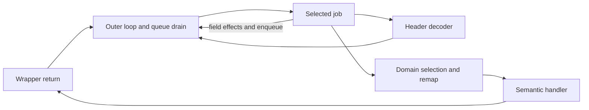

# JACK XXXII — Autonomous outer dispatch

30 October 2026. Starting local and fetched `origin/main`:
`9a81d98d5f95b43fa1fe53f90d161602f1a86ab8`.

## Result

**The semantic interpreter can return to the outer dispatcher, select new work
and continue without native replay.** Dedicated natural captures verify both
requested return RVAs, `0x22bc87` and `0x231c09`. Three further independent
processes execute four consecutive virtual instructions from one initial state:

```text
PC 0  PUSH_POOL_U32 -> PC 5
PC 5  STORE_REG_U16 -> PC 8
PC 8  LOAD_REG_U16  -> PC 11
      outer return -> work queue -> decoder -> domain selection -> handler
PC 11 PUSH_POOL_U32 -> PC 16, SP 2
```

The fourth instruction reuses an existing opcode. The central advance is
autonomous scheduling, not an increase in the recovered ISA from three opcodes.
No intermediate capture is restored. Observations are opened only after the
candidate finishes. Tests execute the candidate with Unicorn calls blocked and
also in a fresh process where neither Unicorn nor Z3 can be imported.

Evidence: [validation](jack_xxxii_evidence/validation.json),
[pinned corpus](jack_xxxii_evidence/corpus.json),
[state matrix](jack_xxxii_evidence/status.json),
[tests](jack_xxxii_evidence/unit_tests.json),
[counterexamples](jack_xxxii_evidence/counterexamples.json).

## 1. Outer dispatcher first

The native return does not simply reset the thread budget. The outer function
checks halt/label state, enters its loop, drains queued work, refreshes encoded
controls, checks the guard and selects a flattened job by control slot 0.



The recovered queue mechanisms are:

- `RVA 0x1f0db0`: increments `ctx+0xad8`, encodes a job with the live queue key,
  checks remap/exception conditions, and appends to the 64-cell work queue.
- `RVA 0x1f0c50`: consumes up to eight queued items in LIFO order, decodes the
  selected job, evolves the queue key, calls one of eight context callbacks,
  and reseals control slot 0. Queue cells retain the native residual bytes.
- Eight callbacks change the key at `+0x20`, scheduler hash at `+0x348` and/or
  queue key at `+0xac8`. Their bindings are read from `ctx+0x288`.

**Callback position is not callback identity.** A first prototype assumed the
same slot order as a retained capture and rejected a new valid process. Its
table was rotated. The model now dispatches by the actual pointer's verified
PE RVA; an unknown target fails explicitly. Native callback disassemblies and
the natural before-states are retained.

The candidate requires the observed native-frame contract explicitly:
context at initial RSP+0x190, R12=0, and R15=`0x27f17`. It reads the threaded-mode
flag from captured frame memory. These are checked route contracts, not a
universal Serial ABI.

## 2. Reducing the flattened state graph

[The offline reducer](scripts/pafet_serial_jobs_xxxii.py) reads the original PE,
symbolically evaluates frame expressions and proves constant branch choices
with Z3 bit-vectors. It retains wrapping widths and rejects unknown reads,
helpers, flag dependencies and unproved branches. Real input-dependent tail
branches remain explicit choices.

The generated [field-effect kernels](devirt/serial_jobs_xxxii.py) contain no
native execution counter, native register file, native stack or x64 instruction
stream. Native RVAs are retained only as boundary/provenance metadata. At
runtime they read named virtual fields, calculate expressions, write fields,
apply the recovered feedback operation and enqueue work. Z3 is an offline build
dependency only.

There are 64 generated kernels: 60 ordinary field-effect jobs and four table
selectors. Four post-opcode tails and seven other jobs use explicit semantic
implementations, including the decoder, domain dispatch and the unarmed
attestation gate. Eight outer states remain unsupported. These are protector
states, not 75 newly recovered virtual opcodes. See
[jobs and gaps](jack_xxxii_evidence/jobs.json) and
[post-opcode tails](jack_xxxii_evidence/tails.json). The new corpus observes 61
of the 64 generated kernels and all eight callback targets. The other three
have static reduction only; [kernel coverage](jack_xxxii_evidence/kernel_coverage.json)
lists them explicitly.

For example, job `0xaf70b` reduces to:

```text
scheduler_hash = mix(scheduler_hash XOR 5)
feedback(decoder_key XOR scheduler_hash, 0x31713)
enqueue(0x1f777e)
```

The feedback and enqueue still have their full encoded-state effects. The
logical virtual PC may remain unchanged across many such jobs. Removing them
would change later keys, tags, counters and dispatch decisions.

The unarmed attestation gate still performs all control reads/reseals and
key/hash updates. Two pure helper results are masked out when control 6 is
unarmed; their lack of persistent writes is checked against the disassembly.
The armed route fails explicitly. Halt/cleanup, exception delivery, remaining
outer jobs and the unvalidated post-wrapper fallback enqueue also stop rather
than borrow native execution.

## 3. Delimited remap rebuild

After closing outer scheduling, two new processes were captured specifically at
`RVA 0x2297e0`, ending at that helper's actual return address. Read-only selection
required fetch count >=1, so these are rebuilds after initialization, not forced
initial states. Their entry fetch counts are 26 and 2.

| Helper process | Native instructions, entry through RET | Result |
|---|---:|---|
| `remap_a` | 110,301 | Original x64/Windows and scalar full-state comparisons pass |
| `remap_b` | 109,412 | Original x64/Windows and scalar full-state comparisons pass |

[The scalar rebuild](devirt/serial_remap.py) derives its seed and XOR mask from
the before-state, shuffles all four 62-entry domains, rebuilds both permutation
directions, resolves targets through the original PE tables and constructs 248
relative dispatch entries. With the dynamic pool enabled, it regenerates the
pool key, all 248 32-byte thunks and their padding, the codec-use bitmap,
domain seed and rebuild counter. All four observed thunk codecs are modeled.

Comparison covers the full declared context, register banks, all virtual stack
cells, bytecode/shadow/bitmaps, dispatch table, complete 7,968-byte pool and
writable PE state. The two Windows proofs cover dynamic-pool mode. The static
pool branch is reconstructed from code but has no new native differential proof.

The rebuild is integrated into the scheduler's periodic rebuild condition and
the decoder hook. The three four-instruction proofs do not happen to trigger
it. Therefore **isolated helper equivalence is not claimed as a continuous
four-instruction rebuild-path proof**.

## 4. Laboratory defect: readonly PE relocation

The first helper comparison exposed a replay loader defect independent of the
semantic reconstruction. The scalar result already matched Windows, but the
original-x64 replay first differed at `RVA 0x229a90`, observation 2,204, after
2,203 coincident instructions.

The instruction loaded a pointer from PE RVA `0x3e95a0`. Windows read its
relocated value; Unicorn read `0x1403eac70`, the preferred-base pointer.
The PE has a `DIR64` relocation at this RVA. The incorrect readonly image was
already present at replay initialization; this instruction was the first
observed register/read divergence.

Cause: `validate_entry()` relocated a `pefile.PE`, then Replay reused it for a
second `get_memory_mapped_image()` call. Its section views could return raw
preferred-base data even though its header now named the runtime base.

Fix: validation and native-image mapping own separate pristine PE objects.
Relocation uses only original PE bytes and the captured runtime base. No
expected register, observed output or repaired snapshot supplies the pointer.
Both complete helper traces now pass. The original failure remains in
[the loader counterexample](jack_xxxii_evidence/remap_loader_counterexample.json),
with a targeted regression checking readonly pointer initialization.

## 5. Returning, selecting and executing

The header decoder was separated from inline domain selection, preserving the
old model's behavior. The outer route decodes a header, enqueues job `0x825f`,
computes the next domain, enqueues its work, remaps/resolves the handler, reads
the captured threaded-mode flag and starts a fresh threaded call. Its next
instruction consumes only the state produced by the preceding instructions
and scheduler.

| Four-step process | Scheduler jobs | Callback invocations | Native instruction observations | End |
|---|---:|---:|---:|---|
| `four_a` | 3 | 4 | 21,931 | PC 16/SP 2 |
| `four_b` | 114 | 116 | 95,235 | PC 16/SP 2 |
| `four_c` | 59 | 60 | 58,304 | PC 16/SP 2 |

The native total for these three chains is **175,470 instruction instances**,
observing 12 virtual instruction executions and three distinct opcodes. These
counts must not be substituted for each other. Job counts are entries in
`state.jobs`; decoder and terminal handler handoffs are separate work selections.

Separate endpoint captures demonstrate returning to the requested RVAs and
selecting the next decoder work: `return2_b` resumes `0x22bc87` at PC 5;
`outer_c` resumes `0x231c09` at PC 11. Other accepted captures exercise both
early returns and budget exhaustion. The exact PCs, job lists, callback targets
and compared boundaries are recorded per case, not treated as one universal
path.

The full new corpus has 12 complete comparisons totaling 666,999 native
instruction observations. A 100,001-instruction truncated capture is retained
and rejected. Two targeted selection attempts produced no eligible before-frame;
they are retained as selection misses and contribute no coverage. No incomplete
trace is promoted to a successful frame.

## 6. Contracts, negative controls and remaining gaps

Three evidence levels remain separate:

- **Native replay:** original x64 matches Windows CPU/read/write observations,
  with defined flags handled by the existing laboratory contract.
- **Local semantics:** isolated remap effects match measured Windows state.
- **Continuous semantics:** candidate instructions, queue, jobs, decoder and
  handler selection run from one before-state and match every declared memory
  byte at the named boundaries.

The reduced semantic state excludes native CPU temporaries and native stack
scratch. The static selector vectors can be read directly from PE constants
instead of recreating their native scratch copies. Full declared virtual-memory
equality is not equality of the entire process state or final RC4 output.

A one-byte queue-key corruption is detected at `ctx+0xac8`. Tests also reject
unknown callback targets, incompatible frame assumptions, missing counter
memory, invalid instruction limits and unsupported fallback routes. A failed
dispatch latches the state; retries cannot continue from partial mutations.

The remaining outer states are enumerated in `jobs.json`. Armed attestation,
scheduler C++ exception delivery, halt/cleanup, unobserved fallback paths, later
windows, further ISA/CFG coverage and full virtualized RC4 remain open. The
post-PC-16 path has no continuous proof in this operation. No complete Serial-VM
or universal equivalence is declared.

## 7. Reproduction

From repository root, using the normal pinned Python dependencies:

```bash
python -m pip install -r jack_xxiii_evidence/requirements.txt
python -m pip install --target jack_xxxii_evidence/build/deps -r jack_xxxii_evidence/requirements.txt
python scripts/pafet_serial_jobs_xxxii.py
python -m devirt.serial_scheduler_validate
python -m unittest devirt.test_ir devirt.test_serial devirt.test_serial_continuous devirt.test_serial_extended devirt.test_serial_scheduler -v
python -m unittest discover -s scripts -p 'test_pafet_state*.py' -v
python -O -m unittest discover -s scripts -p 'test_pafet_state*.py' -v
python scripts/pafet_lab_xxviii.py --output jack_xxxii_evidence/xxviii_regression.json
python -m devirt.serial_extended_validate --output jack_xxxii_evidence/xxxi_regression.json
python -m devirt.serial_continuous_validate --output jack_xxxii_evidence/xxx_regression.json
python -m devirt.serial_validate --output jack_xxxii_evidence/xxix_regression.json
```

The suite contains 74 distinct tests: 49 IR/Serial and 25 state-contract tests,
with the latter also repeated under optimized Python. XXVIII's known queue/OS
boundary remains explicitly blocked. Its C++ comparisons were not rerun here;
User, Hex and SHA implementations are unchanged.

```python
from devirt.serial_scheduler import ScheduledSerialVMState
state = ScheduledSerialVMState.from_initial_capture(before, original_pe)
steps = [state.step() for _ in range(4)]
```

Fresh native capture uses only the existing controlled Windows laboratory:

```powershell
./jack_xxxii_evidence/capture_outer.ps1 -Username alice -Out jack_xxxii_evidence/build/outer_new
./jack_xxxii_evidence/capture_remap.ps1 -Username alice -Out jack_xxxii_evidence/build/remap_new
./jack_xxxii_evidence/capture_four.ps1 -Username alice -Out jack_xxxii_evidence/build/four_new
./jack_xxxii_evidence/capture_return2.ps1 -Username alice -Out jack_xxxii_evidence/build/return2_new
```

The new counter-based terminal is a read-only observation predicate: a declared
native terminal must be reached with fetch count >=4. Earlier visits do not
terminate the capture or replay. The helper's explicit observation limit is
500,000 instructions, bounded by its return; it is not an instruction count
learned from expected output. `remap_a` predates the entry limit field, so its
validator uses the same 500,000 bound declared in its capture manifest.

Hashes pin raw before-states, observations and collector versions. Earlier
collector/contract archives are referenced from XXX; the intermediate helper
collector and current sources are preserved here. The Windows variant remains
the existing `pafet_pass8.exe`, differing at the two documented SHA-gate bytes;
replay and static reduction use the original `pafet.bin`. Original credentials
and flag remain unknown. No original-PE modification or credential search is
part of this operation.
