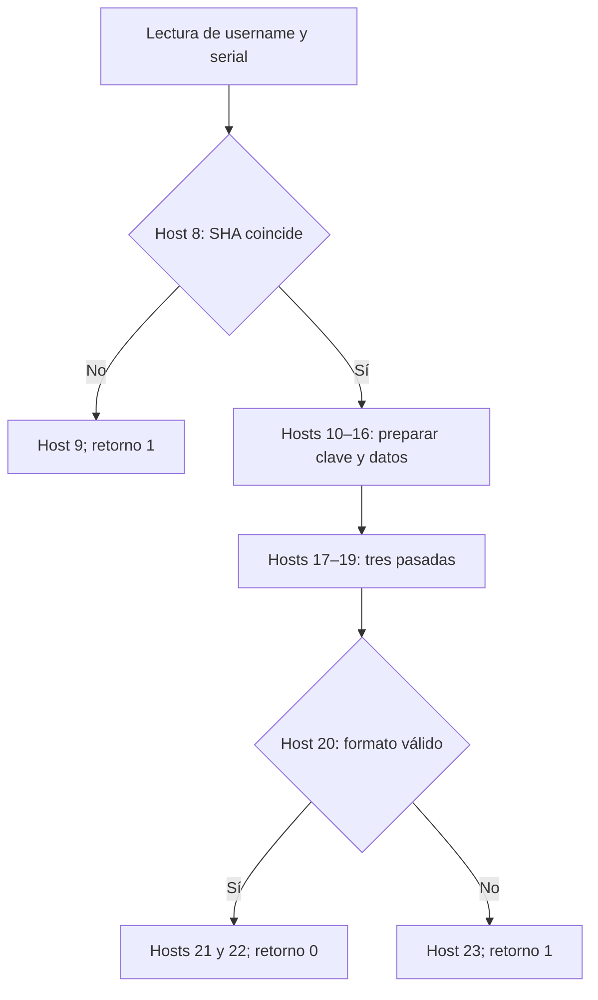

# PAFET — cobertura semántica y auditoría de validación

Fecha: 2026-10-28. **Conclusión D: COBERTURA INCOMPLETA.** No se han obtenido credenciales válidas ni una flag real. La reconstrucción criptográfica permite caracterizar componentes, pero no demuestra que esté agotado el reversing. Esta fase identifica qué sabemos, contrasta rutas adicionales y conserva las regiones que todavía no podemos excluir como relevantes.

La pregunta «¿se ha pasado por alto información tras la virtualización?» sigue abierta. No he encontrado una nueva restricción validada que reduzca el espacio de credenciales. La primera fase corrigió mapas erróneos y demostró una dependencia de memoria en un ensayo de componente. La ampliación actual reconstruye **todo el programa lógico principal**: 105 bloques, 482 instrucciones y su flujo de datos bajo contratos host explícitos. Esto cierra una incógnita concreta, sin convertir la cobertura global en C. Véase `PAFET_CONTROLLER_SLICE.md`.

## 1. Material y criterios de evidencia

Se revisaron el original descargado `Pafet_Challenge.exe`, el ZIP de recuperación, `PAFET_DES3_RECOVERY.md`, los informes históricos, mapas de handlers y scripts de instrumentación. `Pafet_Challenge.exe`, extraído de su archivo original, es idéntico a `pafet.bin` del repositorio: 4.396.544 bytes, SHA-256:

```
fe85e59225387fba4923f3bc6103914fe7b85ba3dc0514c9e37382818fb44d1a
```

El ZIP previo se conserva sin cambios en `audit_evidence/baseline/pafet_cipher_recovery.zip`. Se examinó además el ejemplo fuente generado de REVoid en el commit fijado en `PAFET_REVOID_ASSESSMENT.md`. No se repitió el reversing de DES ni se ejecutaron búsquedas de credenciales.

Se distinguen cuatro clases de evidencia, que pueden coexistir en una misma etapa:

1. **Comprendida:** cuerpo nativo o expresión levantada e inspeccionada, con sus condiciones y efectos. Comprender un callback nativo no equivale a desvirtualizar el intérprete que lo llama.
2. **Caja negra reproducida:** equivalencia comprobada en capturas o componentes, sin demostrar todas las rutas de la VM que lo rodea.
3. **Ejecutada parcialmente comprendida:** se observa PC, opcode o efecto, pero faltan semántica o dependencias internas.
4. **Potencialmente alcanzable no explorada:** no se ha probado su inalcanzabilidad ni se ha caracterizado bajo las condiciones pertinentes.

«Completa» en una fila significa completa **para el componente y alcance expresados**, nunca certificación global del PE. Las simulaciones de retornos host, los targets SHA artificiales y las cadenas de prueba no son aceptación de credenciales por el original. El archivo original no se modifica; los cargadores y dependencias de prueba sí están instrumentados o abstraídos.

## 2. Mapa de etapas

Todas las direcciones son VA con base `0x140000000`. El inventario extraído del PE está en `semantic_evidence/static/static_map.json`.

| Etapa / responsable | Entradas → salidas | Semántica y evidencia | Cobertura / clase | Posible información sobre credenciales |
|---|---|---|---|---|
| CRT `0x1403a46d8` → main `0x1403967a0` | Proceso/CRT → objetos y llamada al intérprete | Main inicializa strings, tabla host y 24 locales; llama a `0x14038d9d0` | Parcial, 1/3/4: no se ha reproducido el arranque Windows completo | Entorno y errores de entrada siguen siendo una frontera, sin pista positiva |
| Programa lógico principal `0x14038d9d0..0x14039677c`; blob `0x1403dca10`, 2730 B | Locales inicializados y contratos host → llamadas, argumentos y retorno | 105 bloques extraídos; 482 instrucciones; CFG y dependencias; 32 contrastes instrucción a instrucción | Completa del programa lógico bajo contratos, 1; runtime nativo aún parcial, 3/4 | No hay comparación adicional ni acceso directo a strings en el programa lógico; 73 instrucciones inalcanzables bajo esos contratos |
| Decoder `0x140380840` | Índice constante → cadena pública | 13 cadenas reconstruidas; los 12 casos no vacíos coinciden con el bucle original en Unicorn | Completa para esos 13 índices y bucle, 1 | No contienen username o serial esperado; sí hash y prefijo. No es un inventario de todo dato posible del PE |
| Hosts main 0–4 y 6, `0x1403969f0..` | Constantes → target/mensajes | Inicializa H y muestra banner/prompts; tabla y cuerpos nativos inspeccionados | Completa de callbacks, 1 | Ninguna comparación de formato de credenciales en estos cuerpos |
| Hosts 5 y 7, `0x140396a79`, `0x140396ab7`; `getline` `0x14039bd20` | Stream → strings `u`, `s` | Delimitador LF; uso de tamaño/capacidad de string; inspección estática | Parcial global, 1/4: CRT y todos los fallos no ejecutados | No se ve filtro de alfabeto ni normalización nativa. El programa lógico principal no añade filtro; siguen pendientes las rutas del runtime/streams |
| Host 8 `0x140396abd`; wrapper SHA `0x1402831c0`, VM `0x14027aba0` | Username original, H → 0 si coincide, 1 si falla | Comparación completa de longitud y digest; 16 pruebas de componente. SHA/padding original ya validado en fase anterior | Completa del comparador; parcial del conjunto VM/streams, 1/2/3/4 | Única condición de username identificada: SHA exacto. No hay preimagen ni máscara nueva |
| VM de usuario `0x14003f540..0x140048925`; host `0x140048960` | `u` → `f(u)` | Siete callbacks inspeccionados; transformación conocida. Treinta proyecciones del bucle con longitudes y retornos de carácter modelados | Completa del cuerpo nativo de transformación; parcial de VM y retorno, 1/2/3/4 | No se encontró otra comparación en los siete callbacks. La equivalencia universal del wrapper no está probada |
| Serial: host 11 `0x140396c36`; VM `0x140264a60`; adapter `0x14039d740`; VM interior `0x14022a120` | Serial y clave pública vacía → máscara RC4 aplicada a `s` | Flujo formal de parámetros inspeccionado; comportamiento RC4 ya contrastado en fase anterior | Parcial de rutas virtuales; caja negra reproducida, 1/2/3/4 | No recibe formalmente el username en este adapter. No se ha demostrado ausencia de toda dependencia global/indirecta |
| Hosts 12–15 `0x140396d87..0x140396f92` | `f(u)`, `r(s)` → clave de 24 B | Concatenación, truncamiento, comparación de tamaño y append de ceros; cuerpos nativos | Completa del componente normal y sus condiciones locales, 1 | Separación y cotas de material conocidas; no aparece una igualdad adicional u–s. Overflow de tamaño lleva a ruta CRT, no es una pista de formato |
| Host 16 `0x140396f92`, VM de hex `0x1400804c0` | 144 caracteres hex constantes → 72 bytes | Carga del blob y llamada a decodificación ya conocida | Comprendida la frontera; interior reproducido, 1/2 | No nuevo dato de credenciales |
| Hosts 17/18 `0x1403970ed`, `0x1403970fb` | Argumento / contador → contador / entero con signo | Setter/getter nativos. Trazas observan 0,1,2,3 | Completa del componente y bucle lógico principal bajo contratos, 1 | Son el contador de las pasadas, no una operación de cifrado o parsing de serial |
| Host 19 `0x140397107`, entrada de cifrado `0x1400c0510` | Clave y datos → una pasada y unpad | Se reutiliza el resumen criptográfico validado; no se reconstruye de nuevo DES | 1/2 para función de bloques; memoria de colas parcial | La cola puede afectar al último byte comprobado. No revela por sí misma la clave |
| Host 20 `0x140397239` | String final → booleano | `size>4`, primeros cuatro bytes `CMO{`, último byte lógico `}`; 15 pruebas de componente | Completa del predicado, 1; llegada real a él parcial | No exige printabilidad ni ausencia de NUL. Metadatos forjados sólo se ensayan como componente, no como exploit |
| Hosts 9 / 21–23 `0x140396b24`, `0x1403972ca..` | Decisión / string final → mensajes y retorno | Mensajes decodificados y flujo contrastado con retornos abstractos | Completa de callbacks, parcial de aceptación global, 1/3/4 | No añaden otra comparación identificada; salida de un oráculo parcheado no es una solución |

### Los 24 callbacks principales, corregidos

| Op | Handler | Operación |
|---:|---|---|
| 0 | `0x1403969f0` | Inicializa el hash target con slot 0; no imprime el banner |
| 1 / 2 / 3 / 4 | `0x140396a51` / `a5b` / `a65` / `a6f` | Separadores, banner y prompt de username |
| 5 / 6 / 7 | `0x140396a79` / `aad` / `ab7` | Lee username, imprime prompt de serial, lee serial |
| 8 / 9 | `0x140396abd` / `b24` | Check SHA / mensaje de username inválido |
| 10 / 11 | `0x140396b2e` / `c36` | Transformación de usuario / transformación de serial |
| 12 / 13 | `0x140396d87` / `ee2` | Concatenación / truncamiento a 24 |
| 14 / 15 | `0x140396f62` / `f78` | Predicado clave corta / append de ceros |
| 16 | `0x140396f92` | Carga y decodifica el ciphertext |
| 17 / 18 | `0x1403970ed` / `0fb` | Escribe / lee contador de pasadas |
| 19 | `0x140397107` | Una pasada de cifrado reconstruido más unpad |
| 20 | `0x140397239` | Comprobación del formato final |
| 21 | `0x1403972ca` | Imprime **Correct!**, slot 9 |
| 22 | `0x1403972d1` | Imprime flag con su longitud lógica, slots 10 y 11 |
| 23 | `0x140397316` | Imprime **Wrong credentials**, slot 12 |

Los números reducidos de las direcciones en las filas agrupadas comparten el prefijo completo indicado en esa fila; el JSON contiene todas las direcciones completas. Los siete callbacks de usuario son: copiar, invertir, escribir índice, comprobar índice<tamaño, transformar byte, leer índice y copiar salida. No se conserva como conclusión la atribución antigua a `std::num_get`: una cadena adyacente en `.rdata` no identifica el tipo semántico de estos callbacks personalizados.

## 3. Trazabilidad de las credenciales

En el contexto host principal, los campos observados y usados por los cuerpos nativos son:

| Offset | Contenido |
|---|---|
| `+0x00` | Hash target H, string |
| `+0x08` | Username original `u`, string |
| `+0x10` | Serial original `s`, string |
| `+0x18` | Transformación de usuario |
| `+0x20` | Transformación de serial |
| `+0x28` | Concatenación de transformaciones |
| `+0x30` | Clave final de 24 bytes |
| `+0x38` | Ciphertext y luego string de salida |
| `+0x40` | Puntero al contador de pasadas |

El hash recibe la cadena `+0x08`, no la transformación `+0x18`, ni el serial, ni una representación hexadecimal del username. Los ensayos de componente conservan espacios, mayúsculas, NUL interno y bytes altos hasta la dependencia SHA. El comparador original rechaza diferencias en el primer y último carácter del digest y en su longitud; los targets de esas pruebas son artificiales y conocidos, para comprobar ambas ramas sin fingir una preimagen real.

En los cuerpos nativos entre lectura y SHA no aparece un trim, filtro de alfabeto o relación con el serial. El levantado completo del programa lógico principal tampoco contiene instrucciones de lectura/escritura de memoria de strings: antes del SHA sólo hay los hosts de inicialización e I/O y operaciones locales. Sus retornos ajenos a predicados se descartan. Esta exclusión se limita al bytecode lógico, no a las guardas del intérprete ni a los interiores de los callbacks. No se obtuvo una nueva cota útil de longitud. Las restricciones de `std::string::max_size`, asignación y recursos son límites de implementación, sin una reducción práctica del espacio de búsqueda identificada.

La transformación de usuario copia e invierte antes de modificar bytes por índice; su bucle expone comparación con el tamaño, no comparación con una contraseña adicional. La proyección de su VM observa la secuencia:

```
0,1,2, (3,4,5,2,5) repetido N veces, 3,6
```

Se probó N=0,1,15,16,17,65 y retornos de carácter 0,127,-128,-1,125 representados a 64 bits. Es cobertura de esos modelos, no demostración de todos los tamaños, valores, guardas o accesos internos.

El adapter de serial recibe serial, clave vacía y temporales/salida; crea el contexto de RC4 interior. No hay un parámetro formal de username ahí. El primer punto nativo identificado donde se combinan ambas entradas es host 12. La relación real sigue siendo compartir la clave concatenada; no se ha encontrado una segunda igualdad entre credenciales.

### Longitud lógica, NUL y capacidad

Los comparadores y el último byte de la salida se rigen por `std::string::size`, usando capacidad sólo para elegir SSO o puntero de heap. El predicado acepta, como componente, bytes `43 4d 4f 7b 00 7d`; no usa `strlen` para decidir dónde acaba el plaintext. La salida host 22 escribe el número de bytes declarado.

Se probaron además dos objetos sintéticos con el mismo backing store `CMO{X}garbage` y tamaños lógicos 6 y 13: el predicado devuelve 1 y 0. **No existe una demostración de que un username o serial pueda forjar esos metadatos en el original.** El ejemplo sólo verifica qué longitud consume la rutina; no es una vulnerabilidad ni una ruta de aceptación.

## 4. Control virtual reconstruido y límites del modelo

La proyección conserva el intérprete principal original y sustituye sus callbacks nativos por efectos modelados. Se variaron las tres decisiones booleanas SHA/padding/formato, dos valores constantes de reloj y dos retornos para llamadas cuyo resultado no debe influir. Los 32 casos concuerdan en la secuencia esperada.



El padding añade host 15 sólo si host 14 devuelve 1. Con fallo SHA, los diez primeros callbacks son 0..9 y no se alcanza la derivación. La rama con formato favorable llega a 21 y 22; la desfavorable llega a 23. Son retornos abstractos elegidos para estudiar el control, **no una aceptación real**.

El PC no es un entero plano del contexto. Se recuperó su expresión de máscara/nonce y se contrastó con el getter original en doce casos. Se instrumentó también el lookup de handlers, que selecciona clones y thunks en heap. Ocho combinaciones de decisiones alcanzaron:

- Los 24 tipos de callback host principal, en la unión de casos.
- 409 fronteras de instrucción virtual distintas dentro del bytecode principal.
- Los opcodes lógicos `1,4,5,8,21,22,24,26,27,28,29,31,32,41,44,58` de un despachador con capacidad de 62.
- Entre 82 y 459 despachos virtuales por caso, incluyendo saltos y operaciones de ruido.

**Ampliación validada:** ahora se han extraído los 105 bloques de 26 bytes con el materializador original, resuelto su permutación y decodificado las 482 instrucciones. Los 1131 bytes restantes son relleno posterior a un salto incondicional o retorno; todos los destinos son entradas de bloque. Los únicos tipos presentes son esos 16. Los otros 46 tipos del dispatcher no aparecen en este programa lógico. De las 482 instrucciones, 409 son alcanzables al enumerar las tres decisiones booleanas y el contador interno; las otras 73 son inalcanzables **bajo esos contratos**.

Se contrastaron 8248 despachos, 6368 operandos dinámicos y 8976 eventos de pila en 32 ejecuciones proyectadas, además de 716 pruebas de lectores de operandos, 92 de constantes y 361 de permutación/resolución de bloques con instrucciones originales. Todos pasan. Los 24 locales se inicializan a cero por el main original; no se asumen inicializados otros registros. Cada retorno host no usado está seguido inmediatamente de `DROP` en el programa estático, por lo que su irrelevancia no depende sólo de probar cero y `UINT64_MAX`. El slice identifica tres decisiones externas (SHA, padding, formato) y el contador. No aparece otra condición de credenciales en este nivel.

Esto prueba el **programa lógico bajo contratos**, no las invariantes globales de cada guarda, excepción, materializador o VM anidada. La extracción forzada de bloques tampoco demuestra que se ejecutaran naturalmente. El detalle reproducible y las condiciones de falsación están en `PAFET_CONTROLLER_SLICE.md` y `controller_evidence/`.

### Opcode 58

No existe en el intérprete del ejemplo público de REVoid. La traza de Pafet lo muestra después de cargar el cero inicial y el contador del bucle. Se siguieron los thunks hasta cuatro cuerpos originales. Sus instrucciones realizan:

```
w = inmediato & 63
resultado = extensión de signo de los w bits bajos del valor de pila
# En x86-64, w efectivo 0 deja el valor sin modificar por el enmascarado del shift.
```

En esta ruta el inmediato leído es 32. Los cuatro cuerpos coinciden en 168 pruebas de conversión, con lecturas y pila abstraídas. En los cuerpos inspeccionados no hay una comparación de credenciales; su uso observado convierte el contador y no aporta bits de la clave. Explica una operación antes desconocida del controlador. No se atribuye automáticamente esa semántica a todos los opcodes adicionales.

## 5. Las lecturas fuera de longitud sí pueden alcanzar la validación

La prueba antigua de un byte mostraba salidas distintas según slack, pero no comprobaba una consecuencia sobre la aceptación de formato. Esta fase añade un ensayo dirigido reutilizando la primitiva ya validada, sin volver a hacer su reversing.

Se utiliza un **intermedio artificial de 65 bytes**, una clave artificial fija y una sola llamada al host de cifrado. No es el ciphertext real de 72 bytes. Se eligió el último byte de ese intermedio entre 256 posibilidades, manteniendo fija la clave; no se buscó un username o serial real. La fixture queda íntegra en el script.

Las instrucciones originales producen:

| Memoria tras el NUL de la entrada | Longitud de salida | Primeros 64 bytes | Último byte | Predicado original 20, aislado |
|---|---:|---|---|---:|
| Ceros | 65 | Iguales en ambas ejecuciones, con prefijo `CMO{` | `7d` | 1 |
| Bytes `a5` | 65 | Iguales | `f4` | 0 |

Las dos ejecuciones nativas usan `FAST_DES` sin definir. Se ejecutan 18 bloques DES3 en total, únicamente para contrastar esta dependencia de memoria. Sus salidas se suministran después al predicado original en el banco de pruebas aislado. **No es una ejecución completa que acepte credenciales; SHA no se ha superado y el ciphertext es artificial.**

El experimento demuestra una cadena concreta: slack de la entrada del último bloque → byte lógico descifrado → resultado del predicado de formato. Por tanto esa lectura no puede declararse irrelevante para la validación. No demuestra control de slack por las credenciales, corrupción de metadatos, lectura fuera de la asignación, recuperación de clave ni bypass de SHA.

La longitud 65 es compatible con los tamaños que puede dejar un recorte, pero no se ha demostrado que la clave/ciphertext reales alcancen ese caso. Tampoco todo bloque incompleto depende de bytes desconocidos: cuando falta sólo un byte, ese byte es el terminador NUL conocido; con más bytes faltantes se puede consumir también slack. El solver completo sigue siendo conservador ante esas colas.

## 6. Regiones pendientes y experimentos que las cerrarían

| Región pendiente | Qué sabemos / qué falta | Experimento concreto y criterio de cierre |
|---|---|---|
| Runtime principal, separado del programa lógico ya cerrado | El CFG lógico y su slice están completos bajo contratos; falta demostrar que toda ejecución original pertinente respeta esos contratos y el bytecode extraído | En el original Windows, registrar entradas/salidas del intérprete y callbacks, fallos de guardas y accesos de datos externos al estado VM. Contrastar el programa extraído; cualquier salida normal divergente falsaría la equivalencia global |
| Mutación de bytecode/segmentos alrededor de `0x140383a50..0x1403840b1`, máscaras y clones | La extracción canónica coincide en cuatro configuraciones; faltan las invariantes globales de descifrado/guardas y la equivalencia bajo estado normal Windows | Registrar lecturas efectivas y escrituras de los segmentos en las dos decisiones del gate, correlacionando PC lógico con bytes antes/después. No asumir que los buffers sólo contienen attestation |
| VM de usuario y retorno `0x14003f540..0x140048925` → main 10 | Los siete callbacks y el bucle modelado están caracterizados; persisten retornos inconsistentes del cargador en ensayos previos | Ejecutar en Windows el original/oráculos de investigación con N=15,16,17 y bytes iguales, capturando salida de handler 6, temporales de main 10 y registros no volátiles. Comparar con Linux. Cerrar al localizar la divergencia y obtener un modelo reproducible, sin tratarla como restricción del original |
| Serial `0x140264a60` → `0x14039d740` → `0x14022a120` | RC4 reproduce capturas, pero no están justificadas todas las ramas del runtime | Slice desde lecturas de serial/longitud hacia saltos y salida, resumiendo el RC4 ya conocido. Buscar comparaciones ajenas a índices/tamaños, no reconstruir otra vez el algoritmo |
| Wrapper SHA `0x1402831c0`, VM `0x14027aba0` y streams | Core/padding y comparador contrastados; formato completo y errores CRT no ejecutados end-to-end en este cargador | En Windows, capturar los 64 caracteres producidos y el resultado real de host 8 para un corpus pequeño con NUL/espacios/55–64 bytes y errores de lectura. Sin alterar el target ni el salto |
| Guardas, TLS, excepciones y fail-stop `0x140381090` | Hay caminos ejecutados parcialmente comprendidos; el fail-stop inspeccionado no tiene retorno normal y entra en bucle/fallo | Trazar el origen de cada condición que puede desviarse del flujo observado. Distinguir error/terminación de éxito. Probar dependencia de credenciales antes de invertir tiempo en runtime genérico |
| Colas parciales con los 72 bytes reales | Dependencia de memoria demostrada en componente; no se conoce si afecta a la pareja válida | Al disponer de una entrada que alcance la fase de cifrado en un oráculo de investigación, registrar longitudes tras cada trim y bytes realmente leídos en los últimos bloques. Para solución A deberá repetirse con credenciales válidas en el original sin cambios |
| Arranque, I/O y rutas de excepción no recorridas | No hay inventario completo de todos los caminos del PE/CRT | Cobertura del original Windows y slice hacia decisiones; errores de asignación y formato no se convierten automáticamente en rutas de éxito |

El slice del controlador se completó en esta ampliación. El siguiente experimento prioritario es la comparación Windows/Linux del retorno de la VM de usuario; después, slices de wrappers de SHA/serial que resuman las primitivas conocidas. No se justifica reabrir las VMs que sólo implementan DES. Esta lista concreta describe el trabajo pendiente; no lo presenta como realizado.

## 7. Correcciones a afirmaciones históricas

- La VM principal **no** es una macro lineal. Se observan saltos, ramas, registros virtuales y un bucle.
- Los blobs de bytecode no pueden clasificarse como «sólo attestation» porque se haya reproducido su checksum. El PC y el despacho se han seguido durante la ejecución.
- Las referencias a `std::num_get` o cadenas próximas no identifican por sí solas la función de un objeto host personalizado.
- Main 17/18 gestionan un contador. Main 21 es el mensaje correcto y main 23 el incorrecto.
- Reproducir DES, SHA o salidas capturadas no prueba que estén cubiertas todas las guardas o rutas que los rodean.
- Un «assertions passed» de un colector no convierte sus dependencias abstraídas ni las inconsistencias registradas del cargador en ejecución real del original.

## 8. Reproducción y conclusión

Dependencias: Python 3, `pefile`, `capstone`, `unicorn`; Linux x86-64 y GCC para el colector nativo. El ejecutable debe tener el hash indicado. Preparar el cargador siguiendo `scripts/native/README.md`. Desde el repositorio:

```sh
python scripts/pafet_semantic_map.py --out semantic_evidence_new/static
python scripts/pafet_semantic_probe.py
python scripts/pafet_semantic_probe.py --native scripts/native/native_probe --opcode-projection
python scripts/pafet_controller_slice.py --native scripts/native/native_probe --out controller_evidence_new
```

La primera prueba de componente no necesita Windows ni ejecuta DES. La proyección conserva los experimentos de control; `--tail-validation` permite repetir por separado las pruebas históricas de cola, que no se repitieron en esta ampliación. El nuevo slice no ejecuta DES ni SHA. Añadir `--revoid /ruta/VSEC-REVoid` permite repetir el inventario del ejemplo fijado. Los JSON registrados, procedencia, hashes y alcance de los stubs están descritos en `semantic_evidence/README.md` (snapshot anterior) y `controller_evidence/README.md` (ampliación actual).

**D. COBERTURA INCOMPLETA.** No hay una reducción material de credenciales demostrada y no se cumplen A ni B. La condición C requiere descartar con evidencia las rutas relevantes que quedan sin caracterizar; los caminos observados no bastan. El controlador lógico ya no es una región sin decodificar; no ofrece una condición adicional bajo los contratos contrastados. Sí merece la pena resolver la divergencia del retorno de la VM de usuario y auditar las dependencias de los wrappers pendientes. Por ahora no hay evidencia positiva de una pista secreta, y tampoco evidencia suficiente para declarar agotado el reversing.
