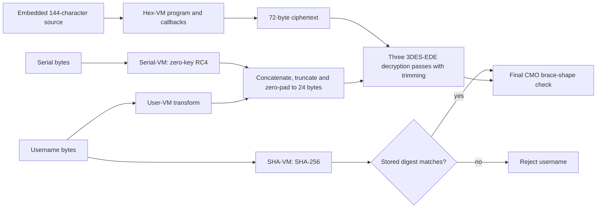

# PAFET — Reverse Engineering a Virtualized Crackme

An independent reconstruction of **PAFET**, the Windows x64 crackme by **NIMA Nikjoo**. This repository studies the executable's four nested virtual machines, their encoded state and dispatch mechanisms, and the cryptographic pipeline they implement.

**The original flag has not been recovered.** The current result is a reproducible research base: a bytecode-to-effect-IR compiler and structured C++ for the logical User-VM program, instruction-level translations of five selected User-VM wrappers, an autonomous literal Hex-VM executor, and functional Serial-VM/SHA-VM implementations. These components have different validation contracts; they are not a claim of complete devirtualization.

The project's final objective is a **clean, readable `pafet.cpp` faithful to the original mechanisms of all four VMs**. Matching outputs or retaining a large literal x64-to-C++ translation is an intermediate result, not that final objective.

Literal Hex-VM baseline: [JACK XXVI, `a3fd245`](https://github.com/ajaniramon/pafet-crackme/commit/a3fd245dfd39dd0cd36a1c47b5534c64f0f138c4). Current semantic work: [JACK XVII — DE VIRTUAL MACHINA](docs/jack-xvii.md), 30 October 2026, following XXVII.

## Current state

| Component | Current implementation | Demonstrated scope | Remaining work |
|---|---|---|---|
| User-VM | [Semantic devirtualizer](devirt/), [structured C++](jack_xvii_evidence/generated/user.structured.cpp), [bytecode model](src/pafet_original_vm_xxiii.cpp) and [native wrappers](src/pafet_lifted_xxiv.cpp) | All 73 materialization segments; 339 instructions lifted; 17 Windows executions and 54,108 logical steps compared; five wrapper bodies checked against original x64 | Complete native encoded state, scheduling, guards and exception behavior; integration into a faithful whole-VM reconstruction |
| Hex-VM | [Literal executor](src/pafet_hexvm_executor_lifted_xxvi.cpp), [translated instructions](src/hexvm_lifted_xxvi/), [CPU model](src/pafet_hexvm_cpu_xxvi.h) and [host services](src/pafet_hexvm_host_xxvi.h) | Initialization through cleanup and return for the validated corpus; 286,214 native push boundaries matched; 10 independent input/output cases | Reduce the literal translation to semantic IR; broaden seed, branch and failure-path coverage |
| Serial-VM | [RC4 implementation](src/pafet_serialvm_native_xviii.h), plus [initialization IR](jack_xvii_evidence/regions/serial.seed.ir.json) | Ten fixed-vector tests and historical memory observations; original blob-seed loop checked per iteration | Recover materialization, opcode format, state, dispatch and the virtualized RC4 program |
| SHA-VM | [SHA-256 implementation](src/pafet_shavm_native_xix.h), plus [initialization IR](jack_xvii_evidence/regions/sha.seed.ir.json) | Twelve fixed-vector tests and historical digest observations; original blob-seed loop checked per iteration | Recover materialization, opcode format, state, dispatch and the virtualized SHA program |
| Crypto/controller | [DES/3DES implementation](src/pafet_des3_xxi.h), [offline oracle](scripts/pafet_des3_offline.py), [behavioral demonstrator](src/pafet_recompile_xxi.cpp) | Recovered key construction, cipher composition and controlled rekeying example | Integrate the newer VM reconstructions; account for native partial-block memory behavior; recover the original credentials/flag |

## Semantic devirtualizer

[JACK XVII](docs/jack-xvii.md) implements **original PE → materialized bytecode → effect IR → readable C++** for the recovered logical User program. The IR preserves wrapping arithmetic, signed comparisons, register/stack effects, host byte-memory operations and deferred control transfers. Unknown semantics stop explicitly. The generated program contains no runtime opcode decoder or captured instruction stream.

The conservative CFG has 339 instructions and 75 blocks. Optimized C++ folds 49 constants and removes 130 dead pure values; a structured backend emits the proved single loop under an enforced initial-register contract. Validation compares 17 Windows executions, the independent bytecode model, IR and generated code, including block states and native byte stores. Native coverage is 334 logical PCs; the other five are exercised only by a separately labelled model control.

Four native initialization regions also pass original-x64/IR/C++ comparisons at 10,179 iteration boundaries. They establish blob references and seed folds for User, Serial, SHA and Hex, **not a shared ISA or decrypted Serial/SHA program**. See the [status matrix](jack_xvii_evidence/status_matrix.json), [validation](jack_xvii_evidence/validation.json) and [reproduction commands](docs/jack-xvii.md#7-reproduction).

The [native-state follow-up](docs/native-state-divergence.md) identifies XXVII's capture flaw: pointed register/stack arrays on the native stack were omitted and replayed as zeros. New hardware single-step traces locate the first affected reads, then match **31,990 native instructions** with complete entry inputs; six corrected Frida frames also pass C++/x64/native comparisons. Old incomplete snapshots are rejected rather than repaired from expected results. This resolves that input-capture cause while broader native VM coverage remains open.

## Native-state laboratory

[JACK XXVIII — ESTADO CERO](PAFET_JACK_XXVIII.md) adds a validated entry-state contract, byte-level input coverage, pinned capture hashes and a reusable [regression runner](scripts/pafet_lab_xxviii.py). Empty corpora, contradictory aliases, missing CPU/memory inputs and truncated native observations fail explicitly. Replay runs from before-state alone; expected outputs never repair its inputs.

The [new corpus](jack_xxviii_evidence/corpus.json) adds **5,837 Windows/Unicorn instruction comparisons in six complete regions**: four User-VM regions (5,813 instructions), a six-instruction cookie check and an 18-instruction Serial initialization region. C++ also matches the remap, transfer and cookie regions; resolver and STORE_REG paths expose two explicit missing-translation boundaries. The queue exception capture remains blocked at `RtlPcToFileHeader`, with 31 instructions compared and the failing boundary retained. These are finite observed native paths, distinct from logical bytecode coverage and functional crypto tests.

Run `python scripts/pafet_lab_xxviii.py` for pinned native replay, or add `--cpp` under Linux/WSL with GCC for the translation comparison. See the report for reproduction, negative controls, the Serial/SHA reuse assessment and remaining OS/exception-state limitations.

## Executable architecture and evidence identity

PAFET's controller invokes separate virtualized computations for the username transform, serial transform, username digest and ciphertext materialization. Shared helpers and encoding patterns do not establish that all four use an identical interpreter or ISA.

| Boundary | Preferred-image VA | Role |
|---|---|---|
| User-VM dispatcher | `0x14003f540` | Executes the username program; its host callback is at `0x140048960` |
| Hex-VM executor | `0x1400804c0` | Executes the program that builds the ciphertext string |
| Serial-VM executor | `0x14022a120` | Serial transformation consistent with zero-key RC4 |
| SHA-VM executor | `0x14027aba0` | Username digest consistent with SHA-256 |

Addresses refer to the preferred image base `0x140000000`; native captures must account for relocation.

- **`pafet.bin`** is the original PE, used for static extraction and original-instruction execution under Unicorn. Its SHA-256 is:

  ```text
  fe85e59225387fba4923f3bc6103914fe7b85ba3dc0514c9e37382818fb44d1a
  ```

- **`pafet_pass8.exe`** is the existing research variant used by the recent Windows collectors. It differs from the original at file offsets `0x395efb` and `0x395efc`, in the SHA-gate check. Its relevant VM instructions are unchanged. Post-gate observations and injected test inputs do not demonstrate acceptance of original credentials.
- **`pafet_oracle.exe`** and earlier patched/rekeyed binaries are separate research artifacts, not interchangeable with the original PE or the pass8 oracle.

## User-VM: recovered program and selected native wrappers

### Original-bytecode execution

JACK XXIII recovered the complete **1,752-byte program materialization: 73 segments of 24 bytes** from the blob at `0x1403e5020`. These are physical materialization units, not 73 fixed-width instructions. The recovered program has **339 decoded logical instructions**; **334** are reachable under the recorded abstract-state contract.

The [C++ implementation](src/pafet_original_vm_xxiii.cpp) reads the PE's blob, opcode table and constants, materializes the program, decodes variable-length operands and executes logical operations over a stack and 256 registers. It does not use captured IR as its executable program or link the older `f_user` shortcut. The host writer follows the original partial-register operations and MSVC string representation.

The [materializer differential](jack_xxiii_evidence/materializer_differential.json) checks all 1,752 bytes after each request in three contexts, plus 256 permutation inputs against x64. The recovered default bytecode has SHA-256:

```text
a15f43b7d8afa2b3ea2b4cbb77c5ae740a9b4ccc240fbd49fcb9bd8492d5d815
```

The old canonical dump matches only 89 bytes of this result. Its missing-final-segment/SSE explanation and descriptions of block 28 as repeated `0x5A` or block 54 as all zero are superseded. The actual output store is `mov [r9+r8], dl` at `0x140048a3a`; the `xor dl,0x5a` is in the native writer at `0x140048a2c`.

The [Windows/MSVC comparison](jack_xxiii_evidence/windows_msvc_differential.json) covers **13 inputs and 41,864 logical operations**, including empty input and six cases of lengths 23–25 exercising heap-backed strings. It compares decoded PCs, stack, registers and final output. There are **41,863 immediate post-core snapshots**: `a8`, step 779 is missing, and remains explicitly missing; comparison with the next pre-state still passes. This logical-state agreement does not imply reproduction of every native encoding, guard or scheduling decision.

### Dispatch and wrapper bodies

The newer [dispatch evidence](jack_xxiii_evidence/dispatch_coverage_windows.json) observes **60 native code entries** and all **248 non-escape `(channel, alias)` slots** across the 13 inputs. Each slot has multiple targets across the corpus. Code addresses, aliases and generated thunks are distinct identities. Resolver entries and nested `call r9` dispatch must both be tracked; the older fixed 35-handler catalog and dispatch percentages are not exhaustive invariants.

JACK XXIV translates these five selected wrapper bodies and checks them instruction by instruction against original x64 under Unicorn:

| Native entry | Recovered core | Observed + proven-unreachable branch edges |
|---|---|---:|
| `0x14003bea0` | DROP | 32 + 2 / 34 |
| `0x140014a00` | DROP | 32 + 2 / 34 |
| `0x140015820` | Block transfer | 7 + 27 / 34 |
| `0x140025020` | Block transfer | 7 + 27 / 34 |
| `0x1400216d0` | STORE_REG | 32 + 2 / 34 |

They are **not five atomic output-byte writers**. The comparisons include GPRs, RIP, defined arithmetic flags, XMM state and written memory. Local coverage accounts for the bodies under explicit LUT, ABI and non-aliasing assumptions; it does not cover every helper or OS exception path. [JACK XXVII](PAFET_JACK_XXVII.md) recorded an incomplete-frame mismatch. The [follow-up](docs/native-state-divergence.md) corrects pointed-array input capture and validates fresh DROP/rekey frames instruction by instruction against Windows. The User-VM queue-throw path and wider guard/scheduler coverage remain open.

The new [effect-IR/compiler comparison](jack_xvii_evidence/validation.json) adds four Windows captures to those thirteen cases, including length-15/16 storage boundaries and a 23-byte binary input. It compares 54,108 logical steps; 54,105 immediate post-core snapshots are available. The missing snapshots are `a8/779`, `fresh_heap16/932` and `fresh_sso15/1625`, each checked through its next pre-state.

Sources and detailed evidence: [JACK XXIII](PAFET_JACK_XXIII.md), [JACK XXIV](PAFET_JACK_XXIV.md), [JACK XVII semantic pipeline](docs/jack-xvii.md), [logical verification](jack_xxiii_evidence/verification.json), [wrapper coverage](jack_xxiv_evidence/).

## Hex-VM: autonomous literal executor

The current executor is a C++ state-machine translation of **58,662 unique native instructions**, recovered from **187 CFG entry roots**. Roots include switch labels and exception continuations; they are not a count of distinct functions. The [manifest](jack_xxvi_evidence/executor_lift_manifest.json) records source hashes, runtime hashes and untranslated direct-call boundaries.

The [program map](jack_xxvi_evidence/literal_program_map.json) locates native entries for the **72 virtual PCs in the historical corpus**. That number describes an observed program graph, not an exhaustive ISA or all possible execution paths.

The reconstructed machinery includes:

- Stack-resident VM context, encoded registers/PCs and masked bytecode access.
- A pending LIFO work queue and an eight-handler secondary mixer. Its handler-table rotation is initialized once from the initial K and persists as K changes.
- Four remapped domains of 62 entries, resolving to 61 distinct native bodies, with generated thunks and indirect dispatch.
- Decoder, bank changes, state mixing, queue exceptions, the audited catch/unwind path, initialization and cleanup.
- Explicit host services for allocation, clocks, memory operations, cookie checking and standard-library callbacks. Unsupported paths fail rather than acquire invented VM semantics.

### How the 72-byte result is built

The virtual program controls callback operations and the input cursor. The callbacks extract a substring of up to two characters, parse a hexadecimal number through a C++ stream, append its low byte to a `std::string`, and finally copy the completed string to the result object. For the embedded 144-character source this produces the **72-byte ciphertext**.

The sixteen calls through `0x1400889e0` are a separate operation: each reads and refreshes an encoded virtual slot. Their consumers store **16 uint64 values, a 128-byte register buffer**. Those calls do not directly construct the 72-byte string.

The tested parsing behavior includes `abc -> ab0c`, `g0 -> 00`, and a space followed by `a -> 0a`. A conventional strict hex decoder does not reproduce that contract. The standalone runs the recovered program; standard stream/string operations are confined to the callback boundary.

### What the validation establishes

| Evidence | Checked result | Scope |
|---|---|---|
| [Translation manifest](jack_xxvi_evidence/executor_lift_manifest.json) | 58,662 instructions; 187 CFG roots | Static recovery and generated-source identity, not universal reachability |
| [Decoder/remap differential](jack_xxvi_evidence/decoder_literal_differential.json) | Six Windows frames; 333,819 C++ steps | 16 GPRs and non-stack captured pages against Windows; all mapped bytes and defined flags against original x64 under Unicorn |
| [Detailed MSVC replay](jack_xxvi_evidence/executor_msvc_differential.json) | 293,250,162 C++ steps; **286,214/286,214 push boundaries** match | Item, K/A/B, push counter and queue length; final 16 GPRs, complete `0x1200` context, slot/remap/bytecode buffers, 128-byte register buffer and 72-byte string |
| [Standalone differential](jack_xxvi_evidence/standalone_msvc_differential.json) | **10/10 independent input cases** | Initialization through cleanup and return from a fresh synthetic ABI state; output string, all 128 register bytes and return agree with native Windows observations |
| [Portable arithmetic](jack_xxvi_evidence/wide_arithmetic_differential.json) | **1,024/1,024** | Selected multiply/divide/add/subtract instructions, overflow faults and defined flags against independent x64 execution |

The detailed replay starts from a captured initialized frame and uses recorded clock readings. Its 293 million steps are **not** 293 million native instruction-by-instruction comparisons: checks occur at every push and at the final boundaries. It includes 78 queue exceptions and 435 callbacks.

The ten standalone runs instead construct their own VM state, use a deterministic clock and arena allocator, and receive no native VM snapshot, instruction trace or push transcript. They include the real source, empty input, valid mixed-case input, odd length, invalid characters and whitespace. Native initial RFLAGS/XMM are unavailable through these Frida collectors.

Four conclusions must remain separate:

1. **Literal execution:** a full start-to-return executor exists for the validated corpus, with explicit host substitutions.
2. **Functional agreement:** the specified native states and outputs match in the recorded cases.
3. **Reduced semantics:** the smaller [Hex-VM core](src/pafet_hexvm_core_xxvi.h) remains partial; the literal translation is not a recovered compact ISA implementation.
4. **Universal equivalence:** not demonstrated for every seed, branch, host environment, allocation failure or exception type.

See [XXVI functional reconstruction](PAFET_JACK_XXVI_CLOSURE.md) for the complete implementation and evidence inventory.

## Serial-VM and SHA-VM

The Serial-VM replacement implements RC4 KSA/PRGA with the one-byte key `{0x00}`. The [ten-vector C++ test](src/main_serialvm_test_xviii.cpp) matches fixed RC4 expectations. The [native capture record](vm_pools_evidence/serialvm_vectors_xviii.json) reports occurrences of expected output bytes in process memory after execution; its [collector](scripts/pafet_serialvm_capture_xviii.py) searches memory rather than tracing an entire virtualized RC4 computation. Especially for short strings, a memory-pattern hit is a weaker observation than a fully attributed output-state trace.

The SHA-VM replacement computes standard SHA-256. Its [twelve-vector C++ test](src/main_shavm_test_xix.cpp) matches fixed digest expectations; the [native record](vm_pools_evidence/shavm_vectors_xix.json) reports the expected digests in captured memory windows for those short usernames and empty input. Separate [crypto-audit records](audit_evidence/native_audit.json) cover seven message-preparation/compression cases, including embedded NULs and SHA padding boundaries, through an adapted Linux PE host. Those tests stop before complete gate formatting and acceptance.

These implementations establish useful functional contracts and testable pipeline components. They do not reconstruct the two VMs' complete dispatch, encoded state, guards or exception mechanisms. Claims that they are structurally recovered simply because the primitives are standard are unsupported.

## Cryptographic pipeline and the unrecovered flag

The following diagram shows data dependencies, not a complete native execution schedule:



For the tested byte-oriented contract:

```text
f_user(u)[i] = ((u[len(u)-1-i] XOR 0x5A) + 7 + 3*i) mod 256
g_serial(s)  = RC4(key = {0x00}).encrypt(s)
key          = (f_user(u) || g_serial(s))[:24], right-padded with zero bytes
K1, K2, K3   = key[0:8], key[8:16], key[16:24]
F(X)         = D_K1(E_K2(D_K3(X)))             # ECB, 8-byte blocks
P1           = trim(F(ciphertext))
P2           = trim(F(P1))
P3           = trim(F(P2))
```

`trim` removes the number of bytes specified by the final byte when it is in `1..8` and fits the buffer. It does not check that the removed bytes have equal values. This is three repetitions of a 3DES-EDE decryption operation with trimming between passes, not a single standard 3DES invocation.

The [offline oracle](scripts/pafet_des3_offline.py) and [C++ cipher](src/pafet_des3_xxi.h) stop if an intermediate trim leaves a partial DES block. The native binary can read beyond the logical string length, making that tail dependent on memory slack. Therefore arbitrary-input, byte-exact equivalence of the whole pipeline is not established. The [cipher recovery](PAFET_DES3_RECOVERY.md) and [crypto audit](PAFET_CRYPTO_AUDIT.md) document nine traced DES invocations, 144 independently checked round subkeys, block outputs and padding tests. These native-instruction tests use an adapted PE host, not an unmodified Windows acceptance run.

The stored username digest is:

```text
9419f86b97bd379906be72ea80517c075a499d0db0a37499132c2d203cc21420
```

No matching username, original accepted serial or original flag is known. Gate bypasses enable analysis; they do not recover those secrets.

The [JACK XXI demonstrator](src/pafet_recompile_xxi.cpp) accepts configurable gate/ciphertext values. Its rekeyed build prints a deliberately chosen flag for chosen credentials, validating a controlled instance of the recovered pipeline. It still calls the older behavioral User-VM writer and strict Hex decoder, not the XXIII interpreter or XXVI literal executor. It also right-trims input; the byte-oriented native SHA path audited in the crypto report preserves the supplied string bytes. Rekeying neither decrypts the original challenge flag nor demonstrates the final faithful four-VM `pafet.cpp`.

## Methodology

The research combines PE extraction, recursive CFG recovery, native Windows instrumentation, original-instruction execution under Unicorn and compiled C++ differential testing. The expected result must come from a distinct oracle: a native capture or original x64 instructions, rather than a second copy of the candidate formula.

Each comparison has a contract: decoded logical state, native instruction state, a callback boundary or final output. Native VA, virtual PC, alias, physical segment and CFG root are different quantities. Conditional unreachable-edge proofs supplement local coverage; neither a complete trace nor a matching output establishes coverage of unvisited states.

Source hashes, PE identity, run IDs and archived inputs make results attributable. The [scoped Git attributes](.gitattributes) preserve bytes used by the provenance checks, including the new compiler and its evidence. Historical reports remain dated research records; the implementation and evidence linked above define the current claims.

## Reproduction

Run commands from the repository root unless a block explicitly changes directory. The checked-in JSON files are recorded results. Validation scripts can regenerate tracked reports; inspect resulting diffs when rerunning them.

### Run the packaged Windows Hex-VM

The [Windows package](jack_xxvi_evidence/releases/pafet_hexvm_xxvi_windows.zip) includes the executable, mapped-image data, report and manifest. It needs no Python, Frida, Unicorn or WSL at runtime. Package identity is recorded in [windows_package.json](jack_xxvi_evidence/windows_package.json).

```powershell
Expand-Archive -LiteralPath .\jack_xxvi_evidence\releases\pafet_hexvm_xxvi_windows.zip -DestinationPath .\jack_xxvi_evidence\build\readme_demo -Force
Push-Location .\jack_xxvi_evidence\build\readme_demo
.\pafet_hexvm_xxvi.exe original_mapped_image.bin deadbeef
Pop-Location
```

The first line is `output deadbeef`; subsequent lines contain the virtual register buffer and execution counters. The mapped image supplies data and tables; the C++ model does not load or invoke the original PE as executable code.

### Build and check the User-VM

Use an **x64 Visual Studio Developer PowerShell** with `cl.exe` available:

```powershell
.\src\build_original_vm_xxiii.bat
.\jack_xxiii_evidence\build\original_vm_xxiii.exe pafet.bin 616c696365
# OUTPUT 464340464e
# STEPS 1208
```

For the recorded Windows logical-state comparison, install Python dependencies and run:

```powershell
python -m pip install -r jack_xxiii_evidence/requirements.txt
python scripts/pafet_windows_verify_xxiii.py --exe jack_xxiii_evidence/build/original_vm_xxiii.exe
```

The trace corpus is checked in under [windows/](jack_xxiii_evidence/windows/) and [reference_traces/](jack_xxiii_evidence/reference_traces/). With GCC on Linux/WSL, build with `sh src/build_original_vm_xxiii.sh`. Native wrapper lockstep and directed-coverage commands are documented in [JACK XXIV](PAFET_JACK_XXIV.md); those harnesses require Linux/WSL, GCC and captured fixtures.

### Build and validate the current Hex-VM

The supplied MSVC builder expects **Visual Studio 2022 Community with the C++ tools at its default installation path**. Python 3.10 was used for this evidence. Frida and Windows are required for new native observations.

```powershell
python -m pip install -r scripts/requirements-hexvm-xxvi.txt
python scripts/pafet_hexvm_build_msvc_xxvi.py
python scripts/pafet_hexvm_executor_diff_xxvi.py --msvc
python scripts/pafet_hexvm_standalone_diff_xxvi.py --msvc --reuse-native
python scripts/pafet_hexvm_wide_diff_xxvi.py
```

The first build consumes the checked-in generated sources and validates their hashes. `--reuse-native` compares against the stored ten-case oracle; omit it to collect fresh native cases. The detailed replay consumes the committed full frame. The [XXVI report](PAFET_JACK_XXVI_CLOSURE.md) lists collectors, regeneration commands and the separate decoder/remap comparison, which additionally uses GCC through WSL. This avoids treating the older `build_hexvm_xx.bat` behavioral test as current VM validation.

### Check the functional primitives and crypto oracle

From the same x64 Developer PowerShell:

```powershell
cl /nologo /EHsc /std:c++17 /O2 src/main_serialvm_test_xviii.cpp /Fe:src/pafet_serialvm_test_xviii.exe
.\src\pafet_serialvm_test_xviii.exe
cl /nologo /EHsc /std:c++17 /O2 src/main_shavm_test_xix.cpp /Fe:src/pafet_shavm_test_xix.exe
.\src\pafet_shavm_test_xix.exe
python -m pip install pycryptodome
python scripts/pafet_des3_offline.py --self-test --parity-test
```

These are primitive/oracle tests, not instruction-level Serial-VM or SHA-VM reconstruction. The rekeyed pipeline demonstration and its older build assumptions are described in [JACK XXI recompilation notes](docs/08-recompilation.md).

## Remaining research

- Reduce the Hex-VM literal translation into a compact semantic model while retaining its demonstrated behavior and explicit state transitions.
- Complete User-VM native encoded-state, dispatcher/guard and exception behavior beyond the validated frames; extend the corrected full-input capture to additional paths, including queue exceptions.
- Recover Serial-VM and SHA-VM virtualization mechanisms beyond their functional RC4/SHA-256 replacements.
- Expand seed, branch, input-length, alias/escape and host-failure coverage. Preserve missing observations as missing, including the one User-VM post-core snapshot.
- Model the native crypto tail when trimming produces partial blocks, and integrate the reconstructed engines into the final readable `pafet.cpp`.
- Recover the original accepted credentials and flag. No corpus result or rekeying example proves that this objective has been met.

## Repository guide

| Location | Contents |
|---|---|
| [src/](src/) | Current interpreters, native translations, host/CPU models, primitive implementations and test programs |
| [scripts/](scripts/) | PE/CFG extraction, collectors, differential harnesses, build and packaging tools |
| [devirt/](devirt/) | Explicit effect IR, User bytecode lifter, optimizer, C++ backends, native captures and differential tests |
| [jack_xvii_evidence/](jack_xvii_evidence/) | Generated readable User program, four initialization regions, native traces, status matrix and validation |
| [jack_xxiii_evidence/](jack_xxiii_evidence/) | Recovered User-VM bytecode, logical program, native traces and comparisons |
| [jack_xxiv_evidence/](jack_xxiv_evidence/) | Wrapper CFGs, lockstep results, directed cases and conditional coverage proofs |
| [jack_xxvii_evidence/](jack_xxvii_evidence/) | Process-cookie captures, historical negative control and the first failing fresh User-VM frame |
| [state_divergence_evidence/](state_divergence_evidence/) | Independent before/after native instruction data, missing-input counterfactuals and corrected capture regressions |
| [jack_xxviii_evidence/](jack_xxviii_evidence/) | Pinned native-state corpus, new User/Serial/cookie captures, explicit queue/C++ blockers and laboratory regressions |
| [jack_xxvi_evidence/](jack_xxvi_evidence/) | Hex-VM manifests, native frames, full/standalone comparisons, arithmetic tests and Windows package |
| [vm_pools_evidence/](vm_pools_evidence/) | Earlier pool, bytecode and primitive observations; provenance and scope vary by artifact |
| [docs/](docs/) | Detailed topic notes, including historical interpretations superseded by the later JACK work |
| [historical_recovery/](historical_recovery/) | Preserved earlier sources and reports |

Research sequence: [XXIII recovery](PAFET_JACK_XXIII.md) → [XXIV wrappers](PAFET_JACK_XXIV.md) → [XXV Hex-VM study](PAFET_JACK_XXV.md) → [XXVI audit](PAFET_JACK_XXVI.md) → [Windows continuation](PAFET_JACK_XXVI_WINDOWS.md) → [literal executor and validation](PAFET_JACK_XXVI_CLOSURE.md) → [XXVII User-VM replay diagnosis](PAFET_JACK_XXVII.md). Older assertions should be read in that chronology, with the linked primary evidence taking precedence.

## Credits and license

**Challenge:** NIMA Nikjoo (NIKJOO). **Research and repository:** Ramón Martínez Tarín (`ajaniramon`).

See [LICENSE](LICENSE) for the MIT terms applicable to repository-authored research material and the separate notice concerning the original challenge and its research variants.
