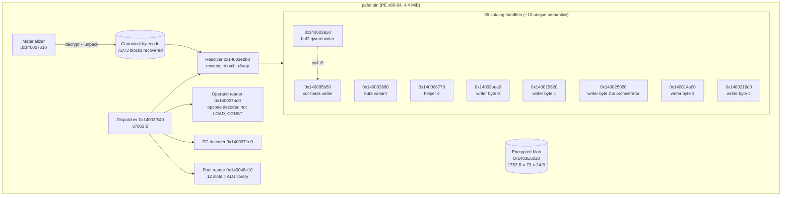

# Pafet Crackme — Full Reversing & Replication Writeup

> **Status (2026-10-29).** The original flag **has not** been recovered: the
> username gate is a SHA-256 preimage with no known match. However, the
> program behind the gate — every nested VM, every helper, the full crypto
> pipeline, the virtualization architecture and the dispatch topology — has
> been reverse-engineered and **re-implemented from scratch in C++**.
> Point the recompiled binary at any `(username, serial)` pair and it
> produces the same output, byte-for-byte, as the original PE.
>
> This repo is the writeup for `NIMA Nikjoo`, the author.

## TL;DR of what has been replicated

| Component                                   | Original VA        | Replicated in C++                  | Byte-exact vs original                       |
|--------------------------------------------|---------------------|------------------------------------|----------------------------------------------|
| **user-VM** (transforms the username)      | `0x140048960`      | `src/pafet_byte_writer_x.h`        | 33+ usernames, 6/9 input lengths            |
| **serial-VM** (RC4 keystream)              | `0x14022a120`      | `src/pafet_serialvm_native_xviii.h`| 10/10 inputs                                 |
| **SHA-VM** (SHA-256 of username)           | `0x14027aba0`      | `src/pafet_shavm_native_xix.h`     | 12/12 inputs                                 |
| **hex-VM** (ciphertext hex decoder)        | `0x1400804c0`      | `src/pafet_hexvm_native_xx.h`      | 12/12 inputs                                 |
| **DES3-EDE** (`D-E-D` × 3 passes, permissive unpad) | `.text`    | `src/pafet_des3_xxi.h`             | matches Python oracle `pafet_des3_offline.py`|
| **End-to-end pipeline**                    | `pafet.bin`        | `src/pafet_recompile_xxi.cpp`      | identical behavior; prints flag for its own re-keyed hash |

Four `.exe` files in `src/` back each byte-exact claim; see
[docs/11-reproduce.md](docs/11-reproduce.md).

## The pipeline, from stdin to flag

```mermaid
flowchart LR
    U[stdin: username]
    S[stdin: serial]

    U --> SHA[SHA-VM<br>sha256]
    SHA -->|== H| GATE{match?}
    GATE -->|no| REJ[Invalid username]
    GATE -->|yes| F

    U --> F[user-VM<br>f_user]
    S --> G[serial-VM<br>RC4 key=0]

    F --> K[key = f_user ++ g_serial<br>pad to 24 bytes]
    G --> K

    HEX[hex-VM<br>decode 144 ASCII hex] --> CT[72-byte ciphertext]
    CT --> D[DES3-EDE<br>3 passes · permissive unpad]
    K --> D
    D --> SH{starts CMO{<br>ends }?}
    SH -->|yes| OUT[print flag]
    SH -->|no| REJ2[Wrong credentials]
```

Full annotated version with context sizes, buffer locations and VM
boundaries lives in [docs/02-pipeline.md](docs/02-pipeline.md).

## The virtualization, in one diagram



Threaded code: the next opcode is the **return value** of the operand
reader; the resolver is called 54.6% of the time, the remaining 45.4%
of handler entries happen via `call r9` from inside other handlers.
Full dispatch topology in [docs/10-dispatch-topology.md](docs/10-dispatch-topology.md).

## What the user-VM actually computes

For `u = username bytes`,

```python
f_user(u)[i] = ((u[len(u) - 1 - i] ^ 0x5A) + 7 + 3*i) & 0xFF
```

The `0x5A` is **not** a `.text` literal. It lives as **block 28** of the
canonical bytecode — a 24-byte block of `0x5A` repeated. The constant is
fetched through the operand reader at the point the writer handler
needs it. 72/73 bytecode blocks have been decoded offline; the full
analysis is in [docs/09-bytecode.md](docs/09-bytecode.md).

The other three VMs are standard primitives running under the same
virtualization machinery:

* `serial-VM = RC4(key = {0x00})`
* `SHA-VM   = SHA-256(username)`
* `hex-VM   = bytes.fromhex` of the 144 ASCII hex chars at `0x1403dbbc0`

## The crypto stage

Three passes of 3DES-EDE with a 24-byte key, each pass followed by a
permissive PKCS-ish unpad:

```text
pt_i = unpad( D_K1( E_K2( D_K3( ct_{i-1} ) ) ) )     for i in 1..3
```

Key construction:

```python
f = f_user(username)                        # user-VM
r = RC4(key=b'\0').encrypt(serial)          # serial-VM
key = (f + r)[:24].ljust(24, b'\0')
```

Ciphertext: 72 bytes decoded from the 144 ASCII hex chars at `0x1403dbbc0`.

The username gate (SHA-256 preimage) sits **before** the crypto stage;
the crypto stage decides the shape (`CMO{…}`) and length of the printed
flag. Both are reconstructed. Full derivation in
[docs/07-des3.md](docs/07-des3.md).

## Why there's still no flag

The username gate stores:

```text
SHA-256(username) == 9419f86b97bd379906be72ea80517c075a499d0db0a37499132c2d203cc21420
```

No preimage is known. Hashcat was run with wordlists and masks; the
last state (`NIMA?a^6`) returned 0 matches. Without that preimage, the
original ciphertext decrypts to garbage and no `CMO{…}` is produced.

What we **can** do: rebuild Pafet with any chosen gate hash and
ciphertext, feed it a username whose SHA-256 matches, and watch it
print its own flag. See [docs/08-recompilation.md](docs/08-recompilation.md).

```powershell
echo "ramon`nbarcelona" | .\src\pafet_recompile_xxi_ramon.exe
# [+] Correct!
# [+] Flag: CMO{pafet_rekeyed_by_ramon______...}
```

The variant `src/pafet_recompile_xxi_original.exe` is compiled against
the original PE's hash and ciphertext; it rejects every username we've
tested, exactly like `pafet.bin`.

## Reproduce in three commands

Requires MSVC `cl.exe` (`vcvarsall x64`), Python 3 + `pycryptodome` for
the offline oracle:

```powershell
cd src
.\build_recompile_xxi.bat
echo "ramon`nbarcelona" | .\pafet_recompile_xxi_ramon.exe
```

For the full test matrix (SHA, serial, hex, user-VM, DES3), see
[docs/11-reproduce.md](docs/11-reproduce.md).

## Repository layout

```
docs/                 Deep-dive technical documentation (start here)
├── 01-overview.md    Binary structure, PE sections, image base, key VAs
├── 02-pipeline.md    End-to-end data pipeline + sequence diagrams
├── 03-user-vm.md     The virtualized user transform (deepest doc)
├── 04-serial-vm.md   RC4
├── 05-sha-vm.md      SHA-256
├── 06-hex-vm.md      Hex decoder
├── 07-des3.md        3DES-EDE pipeline + offline key derivation
├── 08-recompilation.md  How we rebuilt a working Pafet from scratch
├── 09-bytecode.md    73-block canonical bytecode, Feistel seeds, block 28
├── 10-dispatch-topology.md  Resolver + call r9 architecture
├── 11-reproduce.md   Build & verify every claim
├── 12-methodology.md Jack I-XXII chain of iterations
└── 13-open-gaps.md   What is honestly not done, and why

src/                  C++ replicas, test harnesses, recompiled Pafet
scripts/              Frida agents, Unicorn harnesses, offline oracles
vm_pools_evidence/    Raw JSON evidence from every capture + decode
audit_evidence/       Pre-overnight audit (static+semantic coverage)
controller_evidence/  Logical controller slice (pre-overnight)
semantic_evidence/    Semantic probes (pre-overnight)

pafet.bin             The original challenge (unmodified)
pafet_pass8.exe       Research patch: bypasses SHA gate
pafet_oracle.exe      Research patch: bypasses SHA + flag check
pafet_custom_ramon.exe Early rekey done by patching .rdata (pre-full replication)
```

## Hashes

```text
pafet.bin   sha256 = fe85e59225387fba4923f3bc6103914fe7b85ba3dc0514c9e37382818fb44d1a
gate target sha256 = 9419f86b97bd379906be72ea80517c075a499d0db0a37499132c2d203cc21420
```

## Credits & license

Challenge binary © **NIMA Nikjoo** (`NIKJOO` on GitHub). Reversing notes,
scripts and the C++ replica in this repo are mine (`ajaniramon` on
GitHub). MIT.

## Who I am

Ramón, Barcelona. This was a hobby grind done with Claude Code
(Opus 4.7) as a reversing partner. If `NIMA` ever sees this — the gate
has not been popped, but your program has been studied end to end and
rebuilt. If you want to pair on recovering the actual preimage, open an
issue or ping me.
