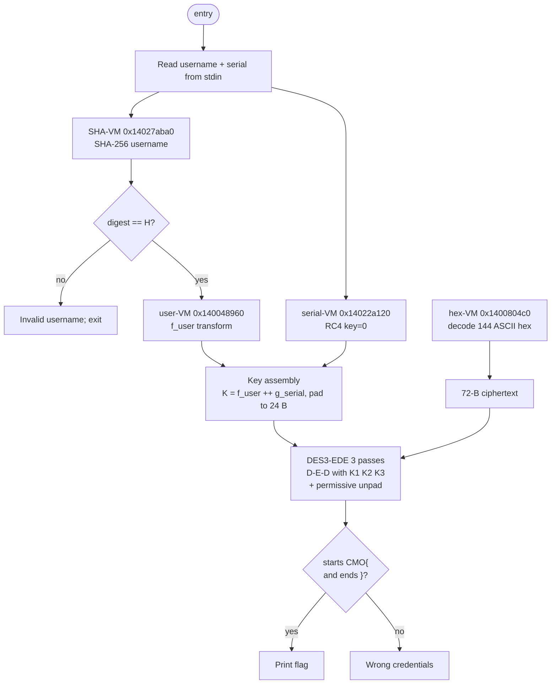
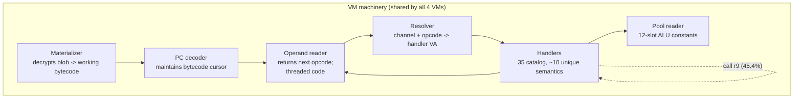

# 01 — Binary & architecture overview

## The PE on disk

```text
File              pafet.bin
Format            PE32+ (x86-64)
Size              4,396,544 bytes
Compiler          MSVC VC++ 2019
Image base        0x140000000
Entry point       runs under VS runtime (CRT, SEH, cookie checks all present)
SHA-256           fe85e59225387fba4923f3bc6103914fe7b85ba3dc0514c9e37382818fb44d1a
```

PE sections of interest:

| Section  | Role                                                 |
|----------|------------------------------------------------------|
| `.text`  | Code — all 35 VM handlers, resolver, dispatcher      |
| `.rdata` | Encrypted bytecode blobs, ciphertext hex, gate hash |
| `.data`  | VM contexts (zero-initialized, built at runtime)     |
| `.pdata` | Exception unwind entries (fragmented for some handlers; see [10-dispatch-topology.md](10-dispatch-topology.md)) |

Key addresses used throughout the writeup:

| VA                 | What it is                                         |
|--------------------|----------------------------------------------------|
| `0x140007610`      | user-VM materializer (decrypts the 1752-B blob)   |
| `0x14003f540`      | Dispatcher body (37,861 B)                        |
| `0x14003ebb0`      | **Resolver** — ABI: `rcx=ctx, rdx=channel, r8=op`  |
| `0x1400074d0`      | **Operand reader** — opcode decoder, returns the *next* opcode (threaded code) |
| `0x1400071e0`      | PC decoder (bytecode cursor advance)              |
| `0x140048e10`      | Pool reader (12-slot ALU shared library)          |
| `0x140048960`      | user-VM executor entry                            |
| `0x14022a120`      | serial-VM executor entry (RC4)                    |
| `0x14027aba0`      | SHA-VM executor entry (SHA-256)                   |
| `0x1400804c0`      | hex-VM executor entry                             |
| `0x1403E5020`      | user-VM encrypted bytecode blob (1752 B)          |
| `0x1403dbbc0`      | 144 ASCII hex chars → 72-byte ciphertext           |
| `0x1400029a0`      | **Panic handler** (`POPS` magic + freeze loop)    |

## High-level flow



## The virtualization layer, conceptually

The author wraps *every* cryptographic primitive (SHA-256, RC4, hex
decode, custom `f_user`) in the **same** VM machinery. Each primitive
becomes a sequence of opcodes operating on a VM context (`ctx`, ~8 KiB
scratch region). The machinery has five fixed components:



What varies between the four VMs:

| VM            | Blob location    | Blob size | Executor VA     | Semantics                 |
|---------------|------------------|-----------|-----------------|---------------------------|
| user-VM       | `0x1403E5020`    | 1752 B    | `0x140048960`   | `((c^0x5A)+7+3i) & 0xFF` on reversed input |
| serial-VM     | (RC4 S-box only) | n/a       | `0x14022a120`   | RC4 PRGA, key = {0x00}    |
| SHA-VM        | SHA constants    | n/a       | `0x14027aba0`   | Standard SHA-256          |
| hex-VM        | 144 ASCII hex    | 72 B out  | `0x1400804c0`   | `bytes.fromhex`           |

The user-VM is the only one with a *decryptable blob*: the author
hid `f_user`'s constants (notably the `0x5A` XOR mask) in 73 encrypted
24-byte blocks that the materializer builds at runtime. The other
three VMs reuse the same opcode mesh over standard constants
(SHA-256 K-table, RC4 S-box, hex alphabet).

## VM context (`ctx`) layout

The 8 KiB context is zero-initialized at VM entry. Observed slots the
reversed handlers touch:

| Offset  | Role                                                |
|---------|-----------------------------------------------------|
| `0x00`  | Bytecode cursor / PC                                |
| `0x28`  | Shadow splitmix state (phi64 × 0x2545f4914f6cdd1d)  |
| `0x30`  | Opcode counter (post-increment)                     |
| `0xb0`  | fmix input slot a                                   |
| `0xb8`  | fmix input slot b                                   |
| `0xd8`  | fmix input slot c                                   |
| `0x1b0` | Bytecode buffer base (**not** output — common pitfall) |
| `0x1e8` | Multiplicand                                        |
| `0x1f0` | Multiplicand                                        |
| `0x1f8` | Multiplicand                                        |
| `0x200` | predicate byte for `cmove`                           |
| `0x208` | fmix slot                                           |
| `0x258` | fmix slot                                           |
| `0x278` | derived-byte scratch                                |
| `0x5b8` | predicate dword                                     |
| `0x5e8` | pointer to **output buffer** (SSO threshold case)   |
| `0xc0`  | SHA-VM output digest window                         |

Every reversed helper reads from and writes to these slots in a
splitmix-shaped round. See [docs/08-helpers.md](08-helpers.md) (part of
[docs/03-user-vm.md](03-user-vm.md)).

## Pre-overnight artifacts (older but still valid)

The repository root carries ~30 Markdown reports produced before the
overnight marathon. Of those, these remain primary sources:

| File                                   | Why it still matters                                   |
|----------------------------------------|--------------------------------------------------------|
| `PAFET_CRYPTO_AUDIT.md`                | Original cipher reconstruction (Spanish, authoritative)|
| `PAFET_DES3_RECOVERY.md`               | DES3 recovery notes (English)                          |
| `PAFET_USERVM_POOL.md`                 | 12-slot ALU pool classification                        |
| `PAFET_USERVM_DEVIRTUALIZATION.md`     | Early devirt work, superseded by [03-user-vm.md](03-user-vm.md) |
| `PAFET_SEMANTIC_COVERAGE.md`           | Semantic coverage report (D outcome at the time)       |
| `audit_evidence/README.md`             | Pre-audit frozen bundle, integrity hashes              |

All later reports (`PAFET_H3880_*`, `PAFET_H3A50_*`, `PAFET_H6770_*`,
`PAFET_HIDDEN_DISPATCH_*`, `PAFET_OPERANDS_*`, `PAFET_OUTPUT_*`,
`PAFET_USER_BYTECODE_*`, `PAFET_USERVM_RIPPER_REPORT.md`,
`PAFET_VIRTUAL_ISA_*`, `PAFET_NIGHT_REPORT.md`) feed directly into the
docs under this folder.
