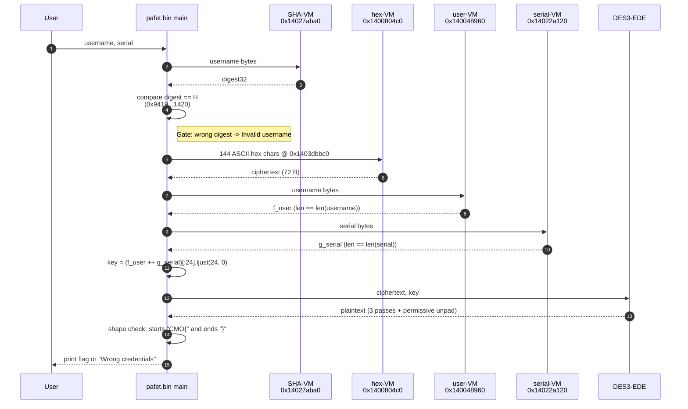

# 02 — End-to-end pipeline

This is the data path from the user typing their credentials to the
flag being printed or rejected. Every stage is a nested VM; the
top-level glue is `.text` code that chains the stages together.

## Sequence (success path)



## Stage-by-stage

### 1. Read credentials

Classical `std::getline` style read from stdin. Right-trim CR/LF. No
length constraint on username; serial is not length-constrained
either, but the DES3 key assembly truncates to 24 bytes total.

### 2. SHA-VM gate — `0x14027aba0`

The username bytes are fed into the SHA-VM. Output is a 32-byte digest
compared verbatim to:

```text
H = 9419f86b97bd379906be72ea80517c075a499d0db0a37499132c2d203cc21420
```

Mismatch → `[!] Invalid username` and exit. No further pipeline work.
Match → proceed to key derivation.

The SHA-VM is `SHA-256`, reconstructed in
[`src/pafet_shavm_native_xix.h`](../src/pafet_shavm_native_xix.h) and
verified byte-exact on 12 inputs including embedded NUL, single-block
and two-block cases. Full details in [05-sha-vm.md](05-sha-vm.md).

### 3. hex-VM — ciphertext materialization — `0x1400804c0`

Reads 144 ASCII hex characters from `.rdata` at `0x1403dbbc0` and
decodes them to a 72-byte binary buffer:

```text
6f56f79c3e348835aa3c3fc5f551d501dea5dfcdcf3a013b0e3f8292ff4954b3
455024b373acad827d1fc843f19f3a9ca9907f072ef55099ceadf0798f782d09
abb0a67da54ba93b
```

Semantically this is just `bytes.fromhex`, but the author wraps it in
the same VM machinery as the other primitives. See
[06-hex-vm.md](06-hex-vm.md).

### 4. user-VM — `f_user` — `0x140048960`

The username bytes go through a position-indexed transform:

```python
f_user(u)[i] = ((u[len(u) - 1 - i] ^ 0x5A) + 7 + 3*i) & 0xFF
```

Three things are notable:

1. The input is **reversed** before being transformed.
2. The XOR constant `0x5A` does **not** live as a `.text` literal. It
   is stored as the 24-byte **block 28** of the user-VM encrypted
   bytecode blob at `0x1403E5020`.
3. Each output byte is produced by one of **5 atomic byte-writer
   handlers** reached through the dispatcher. For a length-5 input
   (e.g. `alice`), the per-position mapping is:

   ```text
   byte 0 -> (ch=3, op=51) -> 0x14003bea0 (300 B handler)
   byte 1 -> (ch=1, op=25) -> 0x140015820 (503 B handler)
   byte 2 -> (ch=2, op=18) -> 0x140025020 (503 B handler + orchestrator role)
   byte 3 -> (ch=0, op=57) -> 0x140014a00 (3586 B handler, .pdata-fragmented)
   byte 4 -> (ch=1, op=43) -> 0x1400216d0 (3705 B handler)
   ```

Full reversing in [03-user-vm.md](03-user-vm.md).

### 5. serial-VM — `g_serial` — `0x14022a120`

The serial bytes go through standard RC4 PRGA with KSA using a
single-byte key `{0x00}`:

```python
g_serial(s) = RC4(key=b'\0').encrypt(s)
```

Byte-exact on 10 inputs. [04-serial-vm.md](04-serial-vm.md).

### 6. Key assembly

```python
key = (f_user_bytes + g_serial_bytes)[:24].ljust(24, b'\0')
```

Observations:

- The zero-padding is **actual content**, not unused string capacity.
  DES3 reads every byte of the 24-byte key.
- DES itself ignores the LSB of each key byte (classical PC-1 parity
  drop). So effectively the entropy per byte is 7 bits.
- The split for 3DES is `K1 || K2 || K3` with 8 bytes each.

### 7. DES3-EDE — three passes with permissive unpad

Each pass computes:

```text
F(X) = D_K1( E_K2( D_K3( X ) ) )          # standard 3DES-EDE in decryption direction
```

Then applies this three times with the same key, unpadding after each
pass:

```text
pt_1 = unpad( F(ct) )
pt_2 = unpad( F(pt_1) )
pt_3 = unpad( F(pt_2) )     # printed as the flag if shape is CMO{...}
```

The **permissive unpad** is:

```python
def unpad(x):
    n = x[-1]
    return x[:-n] if 1 <= n <= 8 and n <= len(x) else x
```

I.e. if the last byte is in `[1..8]` and smaller than the buffer, strip
that many bytes; otherwise leave untouched. This is **not** valid
PKCS#5 (there is no multi-byte check), which is critical when
auditing: a decrypted block ending in `0x02 ??` is NOT stripped by
PKCS#5 but IS stripped by Pafet. See
[`src/pafet_des3_xxi.h`](../src/pafet_des3_xxi.h) and the Python oracle
[`scripts/pafet_des3_offline.py`](../scripts/pafet_des3_offline.py).

### 8. Shape check & flag print

The decrypted plaintext is accepted iff:

```python
pt[0:4] == b'CMO{' and pt[-1:] == b'}' and len(pt) >= 5
```

If accepted:

```text
[+] Correct!
[+] Flag: CMO{...}
```

The flag content is whatever the plaintext says, verbatim. Length is
whatever DES3 unpaddding leaves after 3 passes (72 → 64 → 56 → ...
depending on tail).

## Lengths & padding math

The ciphertext is 72 bytes (9 DES blocks of 8 bytes each). Each pass
runs decryption blockwise through 9 blocks, then unpads once (not per
block). Observed in-the-wild lengths after each pass (for valid flag
inputs we built ourselves):

| Pass           | Bytes in | Bytes out |
|----------------|----------|-----------|
| pass 1 (`F`)   | 72       | 64–71     |
| pass 2 (`F`)   | ← above  | ≤ above   |
| pass 3 (`F`)   | ← above  | 64 (typical for our rekey) |

The last pass's output is the final plaintext candidate.

## Which bytes of the key come from where

For `username = "ramon"` (5 bytes) and `serial = "barcelona"` (9 bytes):

```text
f_user("ramon")       = 3b 3f 44 4b 3b                        (5 B)
g_serial("barcelona") = 7f ae 76 a5 bb ... (9 B, RC4(0))
key[0..4]             = 3b 3f 44 4b 3b          (from f_user)
key[5..13]            = RC4(0)(serial)[0..8]    (from g_serial)
key[14..23]           = 00 00 00 00 00 00 00 00 00 00  (zero-padded)
```

For any `len(f_user) + len(g_serial) >= 24` the pad is empty; for
shorter inputs the pad is actual key material and widely affects the
plaintext.

## Pre-overnight validation

See `PAFET_CRYPTO_AUDIT.md` and `PAFET_DES3_RECOVERY.md` at repo root
for how the pipeline was first discovered (Frida captures, DES trace
matching, parity tests). Overnight work ratified each stage by
building a byte-exact C++ replica of every VM.
