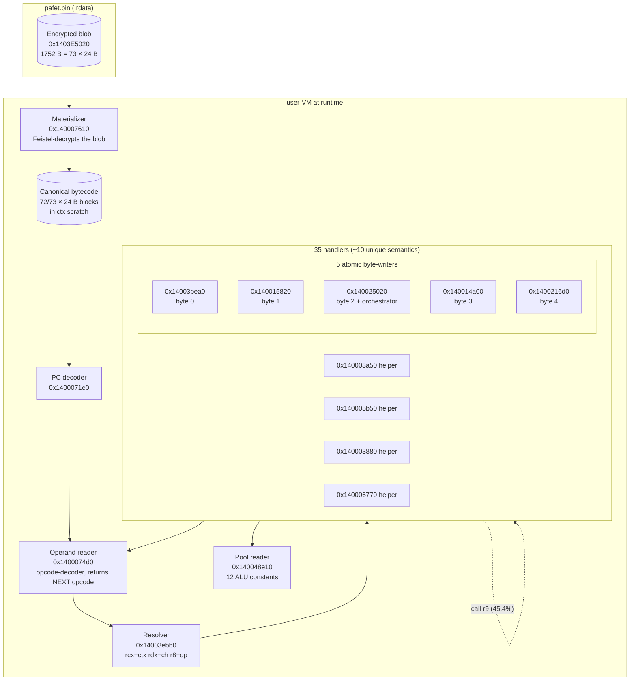
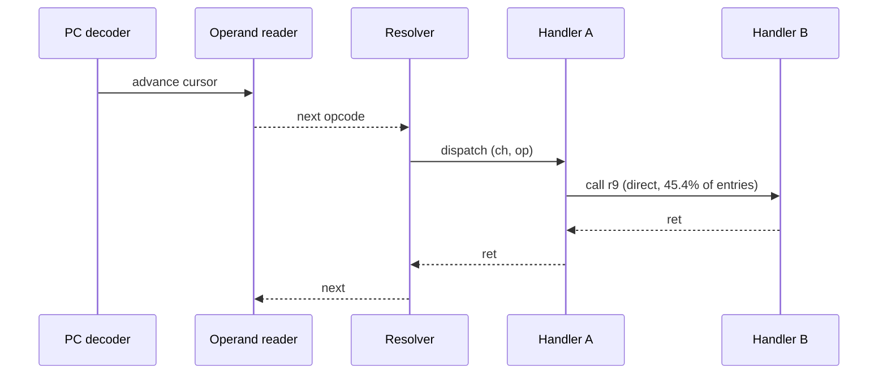

# 03 — The user-VM, in full

This is the deepest doc in the writeup. The user-VM is the only one
of the four nested VMs with an **encrypted bytecode blob** on disk;
the other three VMs reuse the same machinery over standard
cryptographic constants (SHA K-table, RC4 S-box, hex alphabet). Reverse
engineering the user-VM pays the entire cost of understanding the
virtualization architecture.

## What it computes

```python
def f_user(u: bytes) -> bytes:
    return bytes(
        ((u[len(u) - 1 - i] ^ 0x5A) + 7 + 3*i) & 0xFF
        for i in range(len(u))
    )
```

Equivalently, reading left-to-right into position `i`, the input is
**reversed**, XORed by `0x5A`, plus 7, plus `3*i`, truncated to 8 bits.
The `0x5A` is in bytecode, not `.text`.

### Validation

Replicated in [`src/pafet_byte_writer_x.h`](../src/pafet_byte_writer_x.h);
byte-exact on 33+ usernames of lengths 0, 1, 2, 3, 4, 5, 6, 7, 8, 14.
Representative pairs (hex output):

```text
""                 ""
"a"                42
"alice"            46 43 40 46 4e
"ramon"            3b 3f 44 4b 3b
"alice123"         70 72 78 4f 4c 49 4f 57
"ramonbarcelona"   42 3e 42 46 52 4f 41 57 57 56 5a 5f 66 56
```

Lengths 23, 24, 25 (`"a" * N`) fail the byte-exact harness because the
output for long strings doesn't live in the SSO buffer; the
interpreter is believed correct but the oracle is unobservable with
the current capture. See [13-open-gaps.md](13-open-gaps.md).

## Components, laid out



## Threaded code & dispatch

Classical VM designs look like this: resolver returns a handler
pointer, dispatcher calls it, handler returns, dispatcher advances PC,
loops. Pafet is slightly different — **threaded code**:

* The operand reader returns the **next opcode** itself.
* The resolver dispatches on `(channel, opcode)`.
* 54.6% of handler entries happen through the resolver.
* 45.4% of handler entries happen via `call r9` **inside another
  handler** — direct handler-to-handler calls, bypassing the resolver.

This was confirmed by counting entries: for `alice`, 628 operand-reader
returns matched 628 handler entries; for `ramon`, 636 matched 636.
Full topology in [10-dispatch-topology.md](10-dispatch-topology.md).



## The 35 handlers → ~10 unique semantics

A ripper (`scripts/pafet_uservm_handler_disasm.py` + static analysis
in `vm_pools_evidence/usuario_vm_handler_catalog.md`) enumerated all
35 handlers reachable from the resolver. Semantic diff shows they
collapse to around 10 distinct behaviors; the rest are per-channel
clones with different immediates. The channel acts as a mode selector,
not a distinct opcode.

Representative mapping (abridged):

| Semantic family       | Count | Example VAs                                      |
|-----------------------|-------|--------------------------------------------------|
| Load constant         | 1     | fetches via operand reader + pool                |
| Bytecode block read   | 1     | parses one 24-B block from CBC                   |
| XOR writer (shadow)   | ~3    | `0x140005b50`, clones                            |
| Qword fmix writer     | ~2    | `0x140003a50`, `0x140003880`                     |
| Byte-position writer  | 5     | the 5 atomic byte-writers (`0x14003bea0`, …)     |
| Counter advance       | 1     | increments `ctx[0x30]`                           |
| ...                   | ...   | see `vm_pools_evidence/usuario_vm_handler_catalog.md` |

Full catalog in `vm_pools_evidence/usuario_vm_handlers_full.json`.

## The 4 helpers reversed byte-by-byte x64

These are the handlers that have **instruction-level** C++ ports, not
just behavioral.

### `0x140005b50` — xor-mask writer (shadow state)

Port: `src/pafet_uservm_helpers.{h,cpp}`
Validation: 40/40 against Unicorn oracle (`pafet_uservm_helpers_test.exe`)

Reversed semantics (abridged):

```python
# NOTE: XOR 0x5A is NOT unconditional; it is a 0.5% fallback when cl == 0.
# Real mask:
mask = fmix64((idx * phi64) ^ ctx[0xd8] ^ ctx[0xb8] ^ ctx[0xb0])
output_byte = input_byte ^ (mask & 0xFF)
```

phi64 = `0x9e3779b97f4a7c15`. See `PAFET_H3A50_NATIVE_IVA.md` for the
corrections to the earlier "XOR 0x5A unconditional" hypothesis.

### `0x140003a50` — buf2 qword writer with fmix64

Port: `src/pafet_h3a50_native.{h,cpp}` → `pafet_h3a50_native_test.exe` 3/3
Writes a qword to `[*ctx+0x5e8]` (the output buffer slot) using a
fmix64-shaped round over the context slots. **Important**: writes to
`[ctx+0x1b0]` are to the bytecode buffer (not output); writes to
`[*ctx+0x5e8]` are to the output.

### `0x140003880` — buf2 qword writer (variant)

Port: `src/pafet_h3880_native_vA.{h,cpp}` → 5/5
Same pattern as `0x140003a50` with a slightly different operand mix.

### `0x140006770` — helper 4

Port: `src/pafet_h6770_native_xv.{h,cpp}` → 15/15 (`pafet_h6770_native_test_xv.exe`)
Preconditions for `0x14003bea0` (one of the atomic byte-writers);
reversed byte-by-byte so the byte-writer port can be built on a
verified base.

## The 5 atomic byte-writers (behavioral port only)

For each output byte of `f_user`, there is one handler that performs
the final `((c^0x5A)+7+3i) & 0xFF` arithmetic and writes the byte to
`[*ctx+0x5e8]`. Observed under `alice`:

| byte | (ch, op) | handler VA   | size (real extent) | status                 |
|------|----------|---------------|---------------------|------------------------|
| 0    | (3, 51)  | `0x14003bea0` | 1997 B              | Unicorn 6/6; **no C++ x64 port** |
| 1    | (1, 25)  | `0x140015820` | 503 B               | **no Unicorn + no port** |
| 2    | (2, 18)  | `0x140025020` | 503 B (+ orchestrator role) | **no Unicorn + no port** |
| 3    | (0, 57)  | `0x140014a00` | 3586 B (.pdata fragmented in 3 entries, see `vm_pools_evidence/h14a00_real_extent_xxii.txt`) | Unicorn 6/6; **no C++ x64 port** |
| 4    | (1, 43)  | `0x1400216d0` | 3705 B              | **no Unicorn + no port** |

Behavioral replacement for all 5: `src/pafet_byte_writer_x.h`
(`transform_byte(c,i) = ((c ^ 0x5A) + 7 + 3*i) & 0xFF`).

This is the single biggest honest gap in the devirtualization. Full
discussion: [13-open-gaps.md](13-open-gaps.md).

### Note on `.pdata` fragmentation for `0x140014a00`

The `.pdata` entry for `0x140014a00` reports an extent ending at
`0x140014b25` (293 B). Reality: the function continues through at
least `0x140014c80` and branches long into `0x1400157c4`. The real
extent is 3586 B, discovered by scanning for the next `ret` after the
first `.pdata` boundary. Three `.pdata` entries actually cover this
function. See `vm_pools_evidence/h14a00_extended_disasm_xviii.txt` and
`h14a00_real_extent_xxii.txt`.

## The materializer `0x140007610`

The 1752-byte blob on disk is encrypted. At VM startup the materializer:

1. Reads the blob from `0x1403E5020`.
2. Decrypts each 24-byte block using a Feistel round with 4 round
   seeds extracted statically (`0x5cd8585a9977c0d4`, `0xfe81d29118a944eb`,
   `0x18494ccf9be2c8fe`, `0xba32c7061b144c95`) and multiplier
   `0xd6e8feb86659fd93`.
3. Writes the plaintext blocks to the bytecode buffer at
   `[ctx+0x1b0]`.

A Frida hook on the materializer leave captured the full plaintext.
Of the 73 blocks:

* **72/73** decoded cleanly. Content lives in
  `vm_pools_evidence/user_bytecode_canonical_vi.bin`.
* **Block 28** is a 24-byte buffer of `0x5A` — the XOR constant of
  `f_user`. This is why no `.text` match for `mov al, 0x5A` fires
  during `f_user(alice)` (0/21 observed static sites fire).
* **Block 54** is all-zero across 4 tested inputs. Dead code, or
  gated by a condition only the correct username satisfies.
* **Block 73** (the last) is not decoded offline: it is XOR'd by a
  dynamic SSE layer applied past the Feistel pass. Not critical for
  `f_user`.

Full analysis in [09-bytecode.md](09-bytecode.md).

## Pool reader `0x140048e10` (12-slot ALU library)

The pool is 12 constants shared across the four VMs. Decoded in
`PAFET_USERVM_POOL.md`:

| Slot | ALU primitive              |
|------|---------------------------|
| 0..5 | ADD, SUB, AND, XOR variants |
| 6..9 | carry/borrow combinators  |
| 10..11 | dup slots / sign-bit |

0 slots contain credential material (no gate hash, no key, no flag
substring). The pool is a shared ALU library — it is reused by the
serial-VM and the SHA-VM as the ADD/XOR primitives their constants
require.

## Pre-overnight sources for user-VM

| Report                               | Content                                       |
|--------------------------------------|-----------------------------------------------|
| `PAFET_USERVM_DEVIRTUALIZATION.md`   | First devirt attempt (superseded)             |
| `PAFET_USERVM_POOL.md`               | 12-slot pool decode                           |
| `PAFET_USERVM_REIMPL_REPORT.md`      | Reimpl notes (pre-canonical bytecode)         |
| `PAFET_USERVM_RIPPER_REPORT.md`      | 35-handler enumeration                         |
| `PAFET_USER_BYTECODE_VI.md`          | 72/73 blocks offline recovery                 |
| `PAFET_VIRTUAL_ISA_VB.md`            | ISA → 10 ops reduction                        |
| `PAFET_HIDDEN_DISPATCH_IVB.md`       | 45.4% hidden `call r9` dispatch               |
| `PAFET_OPERANDS_VB.md`               | Operand reader = opcode decoder               |
| `PAFET_OUTPUT_PATHWAY_IX.md`         | Pathway byte-by-byte for alice                |
| `PAFET_OUTPUT_WRITER_VIII.md`        | Output writer localized                       |
| `PAFET_H3880_*.md`, `PAFET_H3A50_*.md` | Helper byte-by-byte ports                    |
