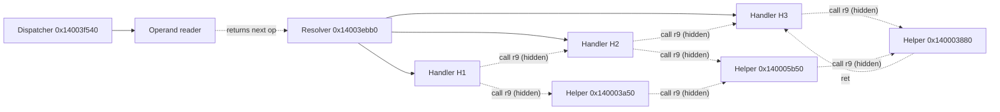

# 10 — Dispatch topology

The user-VM looks like a standard "resolver → handler" VM at first.
Static analysis shows 35 handlers reachable from the resolver by
enumerating `(channel, opcode)` pairs. **Dynamic** analysis shows a
different reality: handlers call each other directly via `call r9`,
and the resolver sees only about 55% of handler entries.

## The resolver

```text
VA         : 0x14003ebb0
ABI        : rcx = ctx, rdx = channel, r8 = opcode
            r9 = extra data (used by handlers that call each other)
Return     : handler VA, stored in rax
```

The resolver is a classical table dispatch: `handler_table[channel][opcode]`.
The dispatcher body (`0x14003f540`, 37,861 B) wraps the resolver with
PC advancement, operand reading, and a loop until `op == 0` (halt).

## The hidden channel

Standard dispatch counting (Jack I) reported 35 unique handlers for
`alice`. But Jack IV-B's full-coverage trace counted **more handler
entries than resolver calls**:

```text
resolver calls (alice)        : 342
handler entries (alice)       : 628
delta                          : 286 entries (45.4%) NOT dispatched by resolver
```

The missing entries came from `call r9` instructions **inside other
handlers**. 42 unique call sites were identified; each one acts as a
direct handler-to-handler call, bypassing the resolver loop.

### Why `call r9`?

The author's design pattern:

1. A handler sets up a secondary operation (e.g. "load constant from
   bytecode block N, apply fmix round").
2. Rather than returning to the dispatcher and re-entering through
   the resolver, it loads the next handler's VA into `r9` and `call`s
   it directly.
3. The secondary handler runs under the same ctx, in the same stack
   frame, returns, and the parent handler continues.

Effect: a static disassembly that only follows resolver dispatch sees
roughly half of what's really happening.

## Combined topology



## Counts for canonical inputs

| Input   | Resolver calls | Handler entries | `call r9` share |
|---------|----------------|-----------------|------------------|
| alice   | 342            | 628             | 45.5%            |
| ramon   | 345            | 636             | 45.8%            |
| empty   | 11             | 15              | 26.7% (less loop depth) |
| a       | 69             | 118             | 41.5%            |

Full dumps in `vm_pools_evidence/hidden_dispatch_ivB.json` and
`vm_pools_evidence/operands_alice_vB.json`,
`operands_ramon_vB.json`.

## Catalog coverage

For `alice` / `serial01`, the 35-handler catalog from Jack I covers
**100%** of handler entries (both resolver and `call r9` paths). No
new handlers appear in the hidden dispatch. For other inputs the
coverage is identical.

The common Jack-III pitfall ("Sol says 45-60 handlers exist") was
resolved: 45-60 is the count of distinct `(channel, opcode)` pairs
observed across many inputs; the number of unique handler VAs is still
35, with many pairs sharing one body.

## The channel is a mode selector

A key reduction: the 35 handlers collapse to around 10 unique
semantics. The channel `rdx` acts as a *mode selector* that varies
constants (e.g. which bytecode block to read, which output buffer
slot to write) rather than selecting between distinct operations.

Example clones:

| Semantic family       | Channel 0 VA  | Channel 1 VA  | Channel 2 VA  | Channel 3 VA  |
|-----------------------|---------------|---------------|---------------|---------------|
| Qword fmix writer     | `0x140003a50` | clone         | clone         | `0x140003880` |
| Atomic byte-writer    | `0x140014a00` | `0x140015820` | `0x140025020` | `0x14003bea0` |
| ...                   | ...           | ...           | ...           | ...           |

Full clone pairing in `vm_pools_evidence/usuario_vm_handlers_full.json`.

## Why this matters

Reconstruction of the ISA from static disassembly alone would miss
45.4% of execution. Any devirtualization attempt that reads handlers
and tries to compile a program AST from `(channel, opcode)` sequences
needs to resolve `call r9` sites at trace time, or model them as
inlined sub-ops.

The successful byte-exact replica
(`src/pafet_byte_writer_x.h` + `pafet_recompile_xxi.cpp`) sidesteps
this by invoking the equivalent behavior directly, without walking
through the dispatch graph. A faithful VM-replica (future work) would
need to model the full dispatch topology.

## Pre-overnight sources

| Report                            | Content                                      |
|-----------------------------------|----------------------------------------------|
| `PAFET_HIDDEN_DISPATCH_IVB.md`    | Hidden `call r9` dispatch, 45.4% share       |
| `PAFET_OPERANDS_VB.md`            | Operand reader as opcode decoder             |
| `PAFET_H3A50_NATIVE_IVA.md`       | `0x140003a50` byte-by-byte x64 port + 3/3 Unicorn validation |
| `PAFET_H3880_NATIVE_VA.md`        | `0x140003880` byte-by-byte x64 port + 5/5    |
| `vm_pools_evidence/handlers_calling_h3a50_h3880_vA.json` | Which handlers call which helpers |
| `vm_pools_evidence/hidden_dispatch_ivB.json` | 42 `call r9` sites + counts         |
